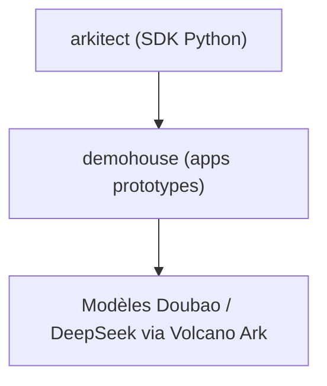

# volcengine/ai-app-lab

> Arkitect Python SDK and demo applications for building LLM apps on the Volcano Ark platform.

## The problem
Going from a model to a business application requires orchestrating model calls, plugins, multimodality and tools.

## What it actually does
Two blocks: Arkitect, the "high-code" Python SDK of the Volcano Ark platform, and Demohouse, a series of open-source prototype applications (DeepSeek-R1 reasoning, real-time voice, long-term memory, mobile agents, Media2Doc, chemistry Skills, investment assistants). The README is in Chinese.

## How it is wired
No diagram; structure based on the README.

## Trying it
No command documented in the README; it points to the Arkitect SDK docs and the online experience hub.

## Cost and gotchas
The demos rely on Volcano Ark models and services (platform account and billing). Ecosystem and documentation in Chinese.

## What it is not
Not a vendor-agnostic framework: it is tailored to Volcano Ark. Not production-ready applications: they are prototypes to adapt.

## Alternatives
No alternative named in the README.

## For you
Watch: useful as a catalog of LLM app ideas, but tied to a Chinese cloud provider and with no documented getting-started.
