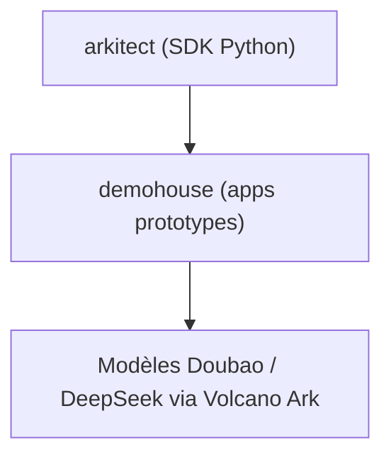

# volcengine/ai-app-lab

> SDK Python Arkitect et applications de démonstration pour bâtir des apps LLM sur la plateforme Volcano Ark.

## Le problème
Passer d'un modèle à une application métier demande d'orchestrer appels de modèles, plugins, multimodalité et outils.

## Ce que ça fait vraiment
Deux blocs : Arkitect, SDK Python « haut code » de la plateforme Volcano Ark, et Demohouse, une série d'applications prototypes en open source (raisonnement DeepSeek-R1, voix temps réel, mémoire longue, agents mobiles, Media2Doc, Skills de chimie, assistants d'investissement). Le README est en chinois.

## Comment c'est branché
Pas de diagramme ; structure d'après le README.

## Essayer
Aucune commande documentée dans le README ; il renvoie à la doc du SDK Arkitect et à la place d'expérience en ligne.

## Coût et pièges
Les démos reposent sur les modèles et services de Volcano Ark (compte et facturation de la plateforme). Écosystème et documentation en chinois.

## Ce que ce n'est pas
Pas un framework agnostique : il est taillé pour Volcano Ark. Pas des applications prêtes pour la production : ce sont des prototypes à adapter.

## Alternatives
Aucune alternative nommée dans le README.

## Pour toi
Surveiller : utile comme catalogue d'idées d'apps LLM, mais lié à un fournisseur cloud chinois et sans prise en main documentée.

