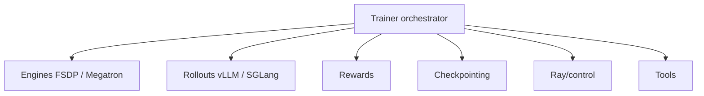

# volcengine/verl

> Reinforcement learning (PPO, GRPO...) training library for large language models, from ByteDance Seed.

## The problem
RL training of LLMs chains generation, reward and update across many GPUs, which wastes memory and communication.

## What it actually does
A controller orchestrates the loop of prompts, generation (vLLM, SGLang, Transformers), reward, advantages, actor and critic update, checkpoint. Training backends FSDP/FSDP2, Megatron-LM and others, Ray orchestration. Verifiable or model-based rewards, multi-turn tool calls, LoRA, wandb or mlflow tracking, NVIDIA, AMD, Ascend support.

## How it is wired


## Trying it
```text
actor_rollout_ref.ref.strategy=fsdp2
actor_rollout_ref.actor.strategy=fsdp2
critic.strategy=fsdp2
```
(Configuration options from the README; installation points to the documentation.)

## Cost and gotchas
Many GPUs for realistic models. Avoid vLLM 0.7.x (memory bugs according to the README). Recipes are pinned to specific versions.

## What it is not
Not a simple supervised fine-tuning tool: it is a distributed RL framework. No installation command in the excerpt.

## Alternatives
- No alternative named in the README.

## For you
Worth watching: a reference for LLM RL (GRPO, DAPO...) if you have GPUs; of little use below several cards.
