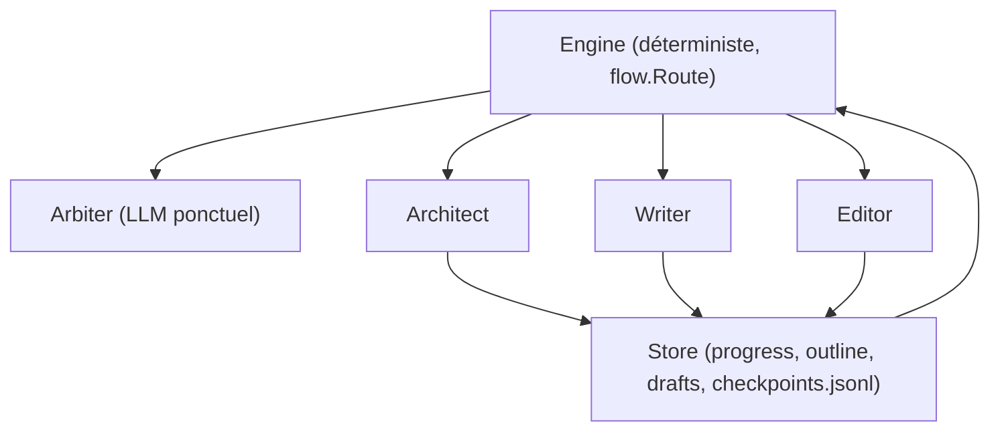

# voocel/ainovel-cli

> Deterministic engine that writes an entire novel by driving three autonomous creative agents.

## The problem
Entrusting a 500-chapter book to an agent loop produces inconsistencies, forgotten plotlines and a hollow outline by the hundredth chapter.

## What it actually does
Strictly separates the factual from the semantic. A deterministic Engine reads the state from a Store, consults a `flow.Route` decision table (a pure function, tested by enumeration) and dispatches without spending a single LLM call. Three autonomous Workers each have their own context: Architect (title, premise, outline, characters, world rules), Writer (outline → draft → consistency check → commit, in that enforced order), Editor (structural and aesthetic review across seven dimensions, each point having to quote the text). An Arbiter is woken up occasionally for bounded judgments, and every arbitration is written to disk, replayable. Rolling-wave planning: only two volumes and the first arc are detailed at the start, the rest is developed as it goes. Resumption at the *step* level thanks to a checkpoint written after every successful tool.

## How it is wired


## Trying it
```bash
curl -fsSL https://raw.githubusercontent.com/voocel/ainovel-cli/main/scripts/install.sh | sh
go install github.com/voocel/ainovel-cli/cmd/ainovel-cli@latest
ainovel-cli
ainovel-cli --headless --prompt "写一本东方玄幻长篇，主角从边陲小城起步"
docker run --rm -it -v "$PWD/config:/root/.ainovel" -v "$PWD/workspace:/workspace" ghcr.io/voocel/ainovel-cli:latest
```

## Cost and gotchas
The program is free, the tokens are not: writing 500 chapters with a frontier model adds up. The README is entirely in Chinese. Configuration lives in `~/.ainovel/config.json`, overridable per project; headless mode has no first-run setup assistant. Models are set per role (`writer`, `architect`, `editor` and three stages of the import pipeline), which lets you put the cheapest one on the mechanical splitting.

## What it is not
It is not a conversational writing assistant: you intervene by injecting an instruction that the Arbiter triages, not by dialogue. It is not a generic orchestrator — no task queue, no policy engine, and it says so itself. And importing an existing novel is for continuing it, not for drawing inspiration from it.

## Alternatives
- No alternative named in the README.

## For you
Of little use in data, but the "deterministic factual layer, autonomous semantic layer" architecture is a pattern to steal for your own agent pipelines.
