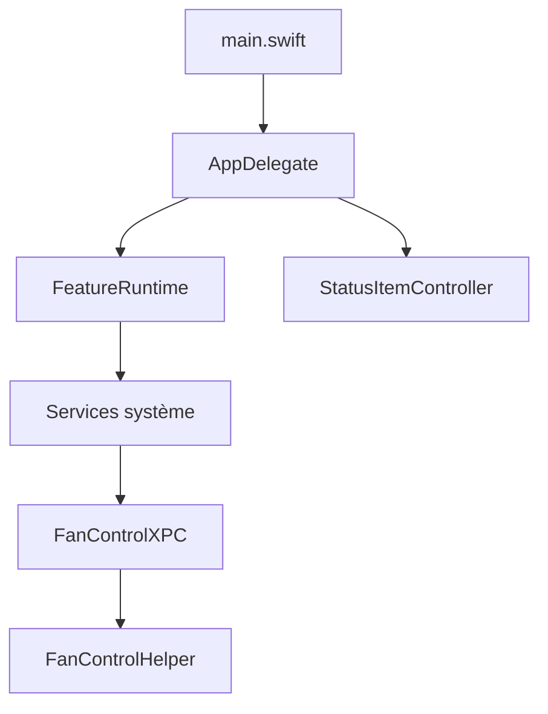

# vorssaint/vorssaint-utils

> Suite of macOS menu bar utilities, local and account-free, for Apple Silicon Mac users.

## The problem
Small Mac utilities (audio mixer, system monitor, clipboard, capture, uninstaller) are bought one by one, each with its own icon and subscription.

## What it actually does
A single Swift application bundles dozens of features: per-application volume, CPU/GPU/temperature monitor, application switcher, window placement, clipboard history, screenshots and screen recordings, uninstaller, Homebrew management. Features are installed à la carte. Fan control goes through a separate privileged helper via XPC. No account, no telemetry; the network is only touched for visible actions.

## How it is wired


## Trying it
```bash
brew install --cask vorssaint
./build.sh --dev
./build.sh --dev --install
```

## Cost and gotchas
Free. Requires Apple Silicon and macOS 14+. Many permissions (Accessibility, screen capture) but all optional. The name and icon are subject to TRADEMARKS.md.

## What it is not
Not portable outside macOS, nor a development or data tool.

## Alternatives
The README names no specific alternatives, only "a dozen paid applications".

## For you
Ignore for your line of work: a comfort utility for a Mac workstation, unrelated to data, AI or MLOps.
