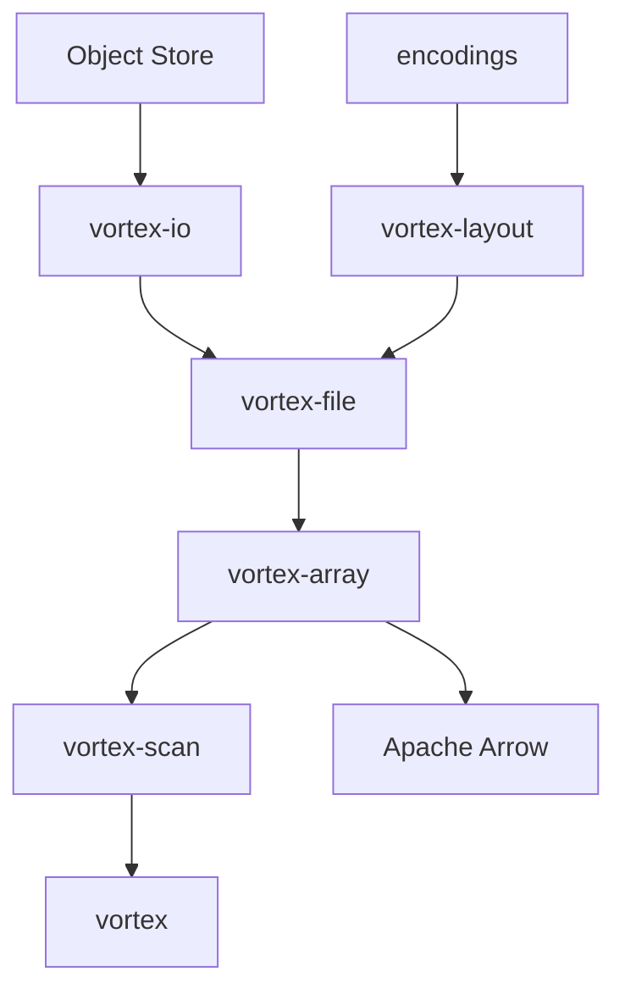

# vortex-data/vortex

> Extensible columnar file format, written in Rust, for data engineers who read from object storage.

## The problem
Parquet imposes its encodings and has slow random reads on object storage. Plugging an engine (DataFusion, DuckDB, Spark) into a better-suited format takes work every time.

## What it actually does
A monorepo of Rust crates: logical schema, physical layouts, pluggable encodings (ALP, RLE, dictionary), vectorized scans. The format is announced as stable since 0.36.0, while the library APIs may still change. Python, Java, C++ and Spark bindings exist. The advertised gains over Parquet (random reads, scans, writes) come from the README and were not verified here.

## How it is wired


## Trying it
```bash
cargo add vortex
uv add vortex-data
uvx --from vortex-data vx --help
```

## Cost and gotchas
Free, Apache-2.0. No key or GPU. Building from source requires Rust (pinned toolchain) and git submodules.

## What it is not
Not a query engine: you need an engine alongside it. Not a replacement already integrated everywhere: the Apache Iceberg integration is "coming soon". The Rust APIs change between versions.

## Alternatives
- Apache Parquet: the standard installed everywhere, compared in the README.
- Nimble: cited among the project's inspirations.

## For you
Worth watching: if you read a lot of data from object storage with DuckDB or DataFusion, the format is worth a test, but the advertised figures are the author's.
