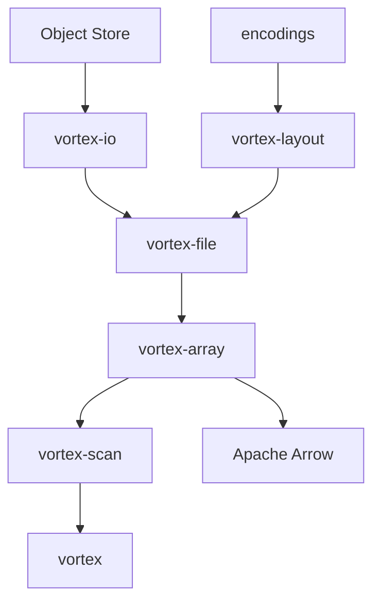

# vortex-data/vortex

> Format de fichier colonnaire extensible, écrit en Rust, pour les data engineers qui lisent sur stockage objet.

## Le problème
Parquet impose ses encodages et ses lectures aléatoires lentes sur du stockage objet. Brancher un moteur (DataFusion, DuckDB, Spark) sur un format mieux adapté demande du travail à chaque fois.

## Ce que ça fait vraiment
Un monorepo de crates Rust : schéma logique, layouts physiques, encodages enfichables (ALP, RLE, dictionnaire), scans vectorisés. Le format est annoncé stable depuis la 0.36.0, les API de la bibliothèque peuvent encore changer. Des liaisons Python, Java, C++ et Spark existent. Les gains annoncés face à Parquet (lecture aléatoire, scans, écritures) viennent du README, non vérifiés ici.

## Comment c'est branché


## Essayer
```bash
cargo add vortex
uv add vortex-data
uvx --from vortex-data vx --help
```

## Coût et pièges
Gratuit, Apache-2.0. Pas de clé ni de GPU. Compiler depuis les sources demande Rust (toolchain épinglée) et des sous-modules git.

## Ce que ce n'est pas
Pas un moteur de requêtes : il faut un moteur à côté. Pas un remplaçant déjà intégré partout : l'intégration Apache Iceberg est « coming soon ». Les API Rust bougent entre versions.

## Alternatives
- Apache Parquet : standard installé partout, comparé par le README.
- Nimble : cité parmi les inspirations du projet.

## Pour toi
À surveiller : si tu lis beaucoup de données sur stockage objet avec DuckDB ou DataFusion, le format vaut un test, mais les chiffres annoncés sont ceux de l'auteur.

