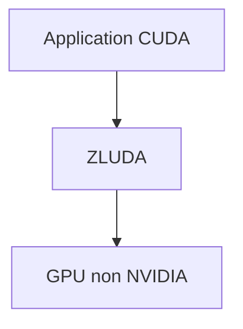

# vosen/ZLUDA

> Drop-in replacement layer for CUDA that runs CUDA applications on non-NVIDIA GPUs.

## The problem
CUDA applications only run on NVIDIA GPUs, which rules out cards from other brands.

## What it actually does
Based on the README's single sentence: run unmodified CUDA applications on non-NVIDIA GPUs, with "near-native" performance. The rest (installation, supported GPUs, limits) is not documented here.

## How it is wired
Simplified diagram based on the sheet, no diagram provided.

## Trying it
No documented command.

## Cost and gotchas
Free. GPU required. Insufficient material: compatibility, driver versions and project status have to be checked outside the README.

## What it is not
It is not a guarantee of full CUDA compatibility: the README gives no list of what works.

## Alternatives
No alternative named in the README.

## For you
Keep an eye on it: the idea directly concerns AI on AMD or other GPUs, but CUDA coverage must be validated before any use.
