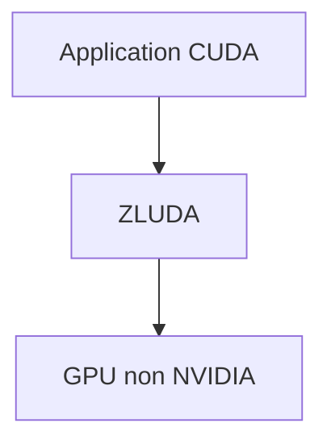

# vosen/ZLUDA

> Couche de remplacement de CUDA pour exécuter des applications CUDA sur des GPU non NVIDIA.

## Le problème
Les applications CUDA ne tournent que sur des GPU NVIDIA, ce qui exclut les cartes d'autres marques.

## Ce que ça fait vraiment
D'après la seule phrase du README : exécuter des applications CUDA non modifiées sur des GPU non NVIDIA, avec des performances « proches du natif ». Le reste (installation, GPU pris en charge, limites) n'est pas documenté ici.

## Comment c'est branché
Schéma simplifié d'après la fiche, sans diagramme fourni.

## Essayer
Aucune commande documentée.

## Coût et pièges
Gratuit. GPU requis. Matière insuffisante : compatibilité, version des pilotes et état du projet sont à vérifier hors du README.

## Ce que ce n'est pas
Ce n'est pas une garantie de compatibilité totale avec CUDA : le README ne donne aucune liste de ce qui fonctionne.

## Alternatives
Aucune alternative nommée dans le README.

## Pour toi
À surveiller : l'idée touche directement l'IA sur GPU AMD ou autres, mais il faut valider la couverture de CUDA avant tout usage.

