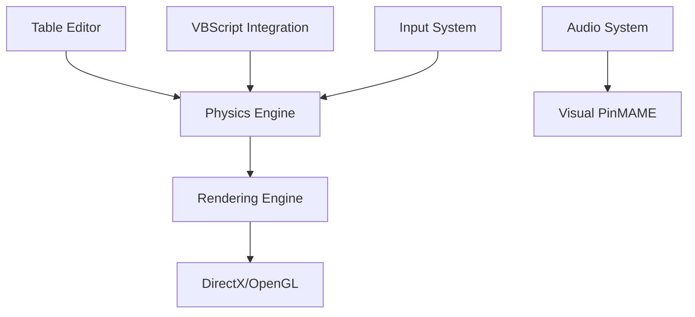

# vpinball/vpinball

> Open source pinball editor and simulator with physics and rendering, for table creators.

## The problem
Creating and playing virtual pinball tables requires a physics engine, rendering and an editor.

## What it actually does
Simulates table physics, renders in DirectX, OpenGL or bgfx, and offers an editor with live editing. Table logic goes through VBScript; PinMAME makes it possible to emulate real machines. Supports VR, stereo 3D, head tracking, touchpad, display plugins. Platforms: Windows, Linux, macOS, iOS, Android, Meta Quest.

## How it is wired

## Trying it
No command documented: download from the releases page; building is described in the README of the `make` folder.

## Cost and gotchas
Free. Sparse documentation, 405 open issues, license not identified by GitHub.

## What it is not
Not a work tool: a hobby simulator.

## Alternatives
No alternative named in the README.

## For you
Ignore: hobby project with no link to data, AI or MLOps.
