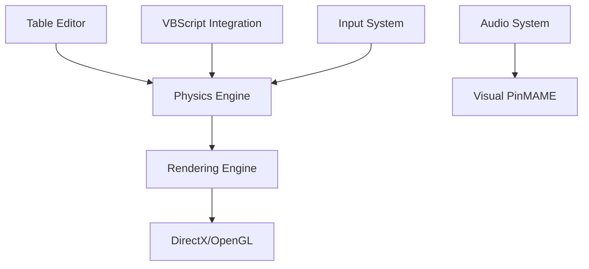

# vpinball/vpinball

> Éditeur et simulateur de flippers open source avec physique et rendu, pour créateurs de tables.

## Le problème
Créer et jouer des tables de flipper virtuelles demande un moteur physique, un rendu et un éditeur.

## Ce que ça fait vraiment
Simule la physique des tables, rend en DirectX, OpenGL ou bgfx, et offre un éditeur avec édition en direct. La logique des tables passe par VBScript ; PinMAME permet d'émuler de vraies machines. Prend en charge VR, stéréo 3D, suivi de tête, pavé tactile, plugins d'affichage. Plateformes : Windows, Linux, macOS, iOS, Android, Meta Quest.

## Comment c'est branché

## Essayer
Aucune commande documentée : télécharger depuis la page des releases ; la compilation est décrite dans le README du dossier `make`.

## Coût et pièges
Gratuit. Documentation peu fournie, 405 issues ouvertes, licence non identifiée par GitHub.

## Ce que ce n'est pas
Pas un outil de travail : un simulateur de loisir.

## Alternatives
Aucune alternative nommée dans le README.

## Pour toi
À ignorer : projet de loisir sans lien avec la data, l'IA ou le MLOps.

