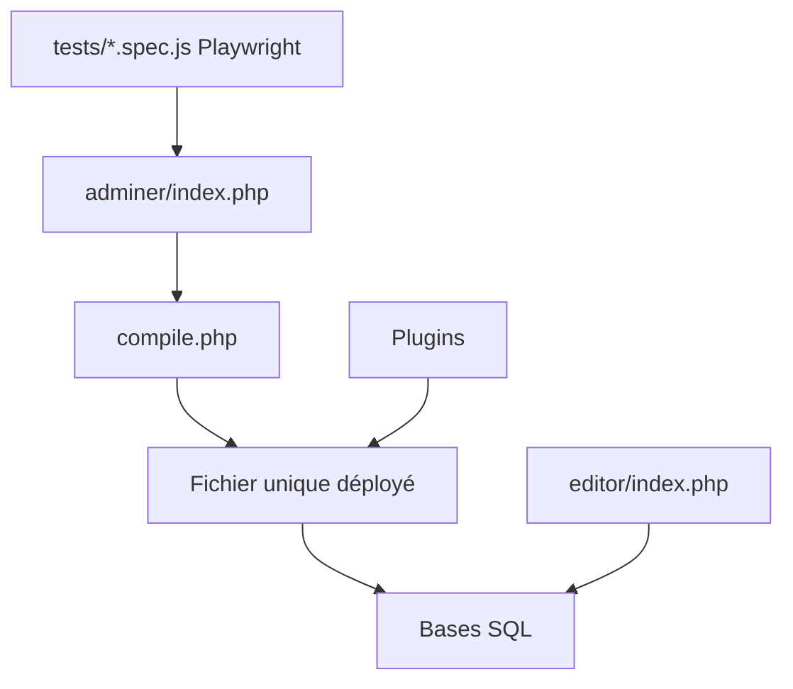

# vrana/adminer

> PHP database administration tool, as a single file to drop on the server.

## The problem
Administering a MySQL, PostgreSQL or SQLite database requires installing a heavy client or a multi-file web application.

## What it actually does
Adminer is a single PHP file to deploy on the target server. It handles MySQL, MariaDB, PostgreSQL, CockroachDB, SQLite, MS SQL and Oracle. Plugins add Elasticsearch, MongoDB, Redis, ClickHouse, etc. Adminer Editor offers data manipulation for end users.

## How it is wired


## Trying it
```bash
git submodule update --init
```
The README documents no other command; `compile.php` produces the single-file version.

## Cost and gotchas
Free. Prerequisites: PHP 5.4+ for the compiled file, PHP 7.4+ for the sources. No account required.

## What it is not
Not a packaged application (no pip, npm or Docker documented). The README gives no security guidance for exposing it on a server. The license is not identified by GitHub.

## Alternatives
No alternative named in the README.

## For you
Adopt for occasionally inspecting a database in a container or on a test server, since a single file is enough; check the license before any redistributed use.
