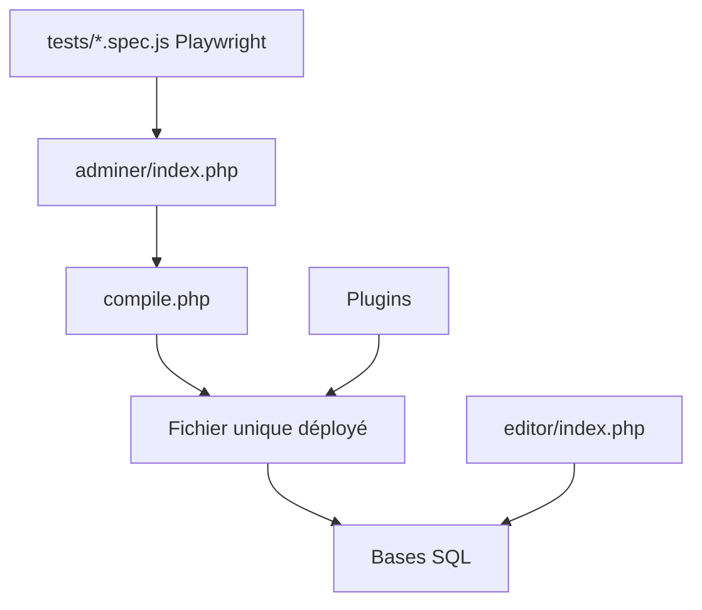

# vrana/adminer

> Outil PHP d'administration de bases de données, en un seul fichier à déposer sur le serveur.

## Le problème
Administrer une base MySQL, PostgreSQL ou SQLite oblige à installer un client lourd ou une application web à plusieurs fichiers.

## Ce que ça fait vraiment
Adminer est un fichier PHP unique à déployer sur le serveur cible. Il gère MySQL, MariaDB, PostgreSQL, CockroachDB, SQLite, MS SQL et Oracle. Des plugins ajoutent Elasticsearch, MongoDB, Redis, ClickHouse, etc. Adminer Editor propose la manipulation de données pour des utilisateurs finaux.

## Comment c'est branché


## Essayer
```bash
git submodule update --init
```
Le README ne documente pas d'autre commande ; `compile.php` produit la version à fichier unique.

## Coût et pièges
Gratuit. Prérequis : PHP 5.4+ pour le fichier compilé, PHP 7.4+ pour les sources. Aucun compte requis.

## Ce que ce n'est pas
Pas une application packagée (pas de pip, npm ou Docker documentés). Le README ne donne pas de consignes de sécurité pour l'exposer sur un serveur. La licence n'est pas identifiée par GitHub.

## Alternatives
Aucune alternative nommée dans le README.

## Pour toi
À adopter pour inspecter ponctuellement une base dans un conteneur ou un serveur de test, car un seul fichier suffit ; vérifier la licence avant tout usage redistribué.

