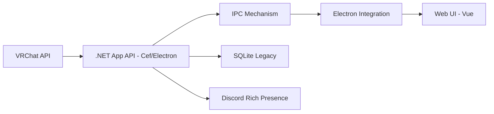

# vrcx-team/VRCX

> Companion application for VRChat: friends, worlds, avatars, notifications and Discord presence.

## The problem
The VRChat client and its website do not make it easy to keep track of your friends, worlds and avatars.

## What it actually does
Manages friend, world and avatar lists outside the game; friendship history, notes, widget dashboard, search, activity map, world metadata in screenshots, notifications, Discord presence, VR overlay, automatic relaunch after a crash, export/import. Uses the VRChat API without modifying the game and is not endorsed by VRChat.

## How it is wired


## Trying it
```bash
# Windows : télécharger VRCX_Setup.exe depuis les releases
# Aucune commande dans le README ; macOS et Linux : pages dédiées.
```

## Cost and gotchas
Free. A VRChat account is required. Works through the VRChat API: subject to its limits and changes.

## What it is not
Not a mod nor a cheating tool. Does not depend on a modification of the game.

## Alternatives
None named in the README.

## For you
Ignore: tool for VRChat players, unrelated to data/AI/MLOps.
