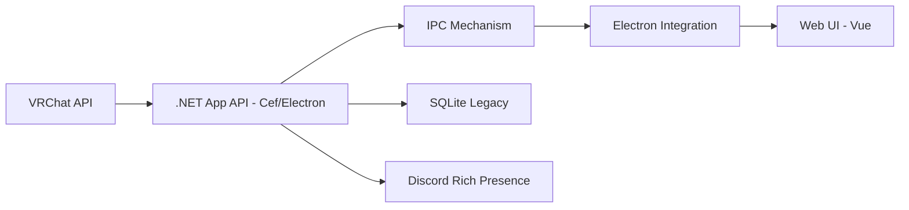

# vrcx-team/VRCX

> Application compagnon pour VRChat : amis, mondes, avatars, notifications et présence Discord.

## Le problème
Le client VRChat et son site ne permettent pas de suivre facilement ses amis, ses mondes et ses avatars.

## Ce que ça fait vraiment
Gère listes d'amis, de mondes et d'avatars hors du jeu ; historique d'amitié, notes, tableau de bord à widgets, recherche, carte d'activité, métadonnées de monde dans les captures d'écran, notifications, présence Discord, surcouche VR, relance automatique après un plantage, export/import. Utilise l'API VRChat sans modifier le jeu et n'est pas approuvée par VRChat.

## Comment c'est branché


## Essayer
```bash
# Windows : télécharger VRCX_Setup.exe depuis les releases
# Aucune commande dans le README ; macOS et Linux : pages dédiées.
```

## Coût et pièges
Gratuit. Il faut un compte VRChat. Fonctionne via l'API de VRChat : sujet à ses limites et à ses changements.

## Ce que ce n'est pas
Pas un mod ni un outil de triche. Ne dépend pas d'une modification du jeu.

## Alternatives
Aucune nommée dans le README.

## Pour toi
Ignorer : outil pour joueurs VRChat, sans lien avec data/IA/MLOps.

