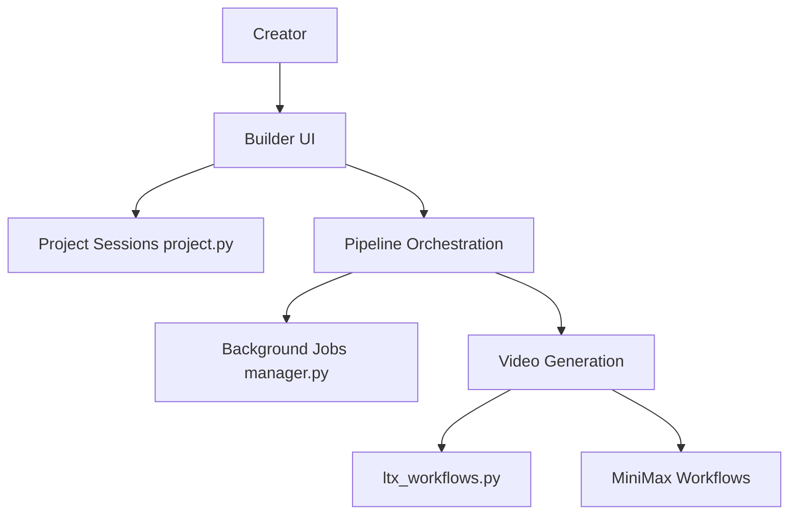

# vrgamegirl19/comfyui-vrgamedevgirl

> Collection of ComfyUI nodes to create AI video clips scene by scene, repair faces and train LoRAs.

## The problem
Producing an AI music video forces you to juggle planning, images, videos, timing and assembly across separate tools.

## What it actually does
The `VRGDG AI Video Builder UI` node opens a workspace: project from audio, SRT or lyrics, storyboard, references, scene images, video rendering (LTX 2.3 and MiniMax H3 workflows), final assembly. Around it: face repair, video enhancement, grain and color grading, dataset creation, LoRA training workflows, VoxCPM2 voice cloning, an MCP server. RAM and VRAM monitoring (via `nvidia-smi`).

## How it is wired


## Trying it
```bash
git clone https://github.com/vrgamegirl19/comfyui-vrgamedevgirl.git
python_embeded\python.exe -m pip install -r ComfyUI\custom_nodes\comfyui-vrgamedevgirl\requirements.txt
```
Or ComfyUI Manager, search `vrgamedev`. Then restart and refresh the browser.

## Cost and gotchas
Free. NVIDIA GPU, external models and companion nodes required. Compiling `llama-cpp-python` may require CMake and a C++ compiler; Python 3.12 recommended on Windows. The API-based LLM options may cost money.

## What it is not
Not a standalone generator: it orchestrates models that you install. The detailed guides are outside the README.

## Alternatives
None named in the README.

## For you
Ignore unless you do generative video production under ComfyUI: the MLOps profile gains little from it, and the license remains to be checked.
