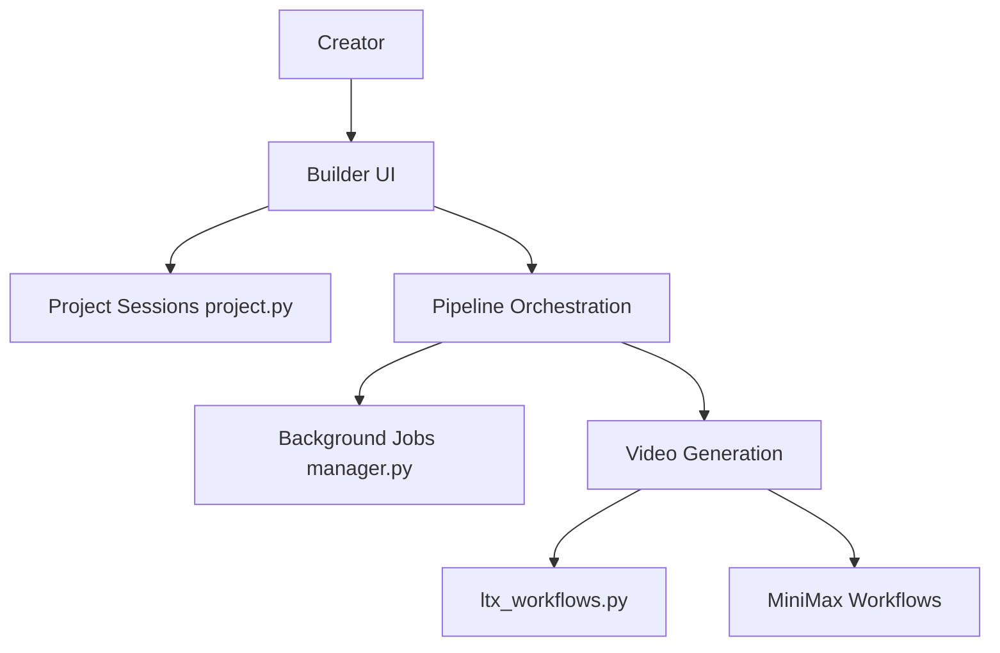

# vrgamegirl19/comfyui-vrgamedevgirl

> Collection de nœuds ComfyUI pour créer clips vidéo IA scène par scène, réparer visages et entraîner des LoRA.

## Le problème
Produire un clip musical IA oblige à jongler entre planification, images, vidéos, timing et assemblage dans des outils séparés.

## Ce que ça fait vraiment
Le nœud `VRGDG AI Video Builder UI` ouvre un espace de travail : projet depuis audio, SRT ou paroles, storyboard, références, images de scène, rendu vidéo (workflows LTX 2.3 et MiniMax H3), assemblage final. Autour : réparation de visage, amélioration de vidéo, grain et colorimétrie, création de datasets, workflows d'entraînement LoRA, clonage de voix VoxCPM2, serveur MCP. Surveillance RAM et VRAM (via `nvidia-smi`).

## Comment c'est branché


## Essayer
```bash
git clone https://github.com/vrgamegirl19/comfyui-vrgamedevgirl.git
python_embeded\python.exe -m pip install -r ComfyUI\custom_nodes\comfyui-vrgamedevgirl\requirements.txt
```
Ou ComfyUI Manager, recherche `vrgamedev`. Puis redémarrer et rafraîchir le navigateur.

## Coût et pièges
Gratuit. GPU NVIDIA, modèles externes et nœuds annexes requis. La compilation de `llama-cpp-python` peut exiger CMake et un compilateur C++ ; Python 3.12 conseillé sous Windows. Les options LLM par API peuvent coûter.

## Ce que ce n'est pas
Pas un générateur autonome : il orchestre des modèles que tu installes. Les guides détaillés sont hors du README.

## Alternatives
Aucune nommée dans le README.

## Pour toi
À ignorer sauf production vidéo générative sous ComfyUI : le profil MLOps y gagne peu, et la licence reste à vérifier.

