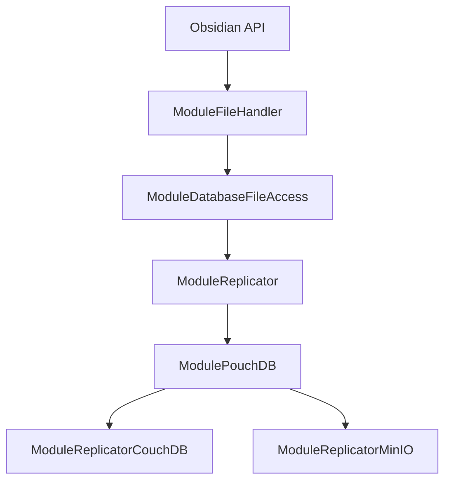

# vrtmrz/obsidian-livesync

> Obsidian plugin that syncs a vault through CouchDB, object storage or WebRTC peer to peer.

## The problem
Obsidian Sync is paid and closed; you need a synchronization that you host yourself, end-to-end encrypted.

## What it actually does
Syncs notes between devices with CouchDB (real time), S3/R2/MinIO object storage (periodic) or WebRTC between devices (a signaling relay is still required). Merges simple conflicts, encrypts end to end and syncs settings, themes and plugins. Connections are shared through an encrypted Setup URI.

## How it is wired

## Trying it
No command in the README: install the plugin in Obsidian, prepare a backend (Docker, Fly.io, IBM Cloudant, R2 or S3), then configure the first device and the following ones through the Setup URI.

## Cost and gotchas
Free, but you operate your own server: example of about 2.34 USD per month on Fly.io, R2 free within its quotas. Mobile: HTTPS is mandatory for CouchDB. Back up the vault before installing.

## What it is not
Incompatible with Obsidian Sync; do not enable it alongside iCloud or another sync tool. No offline peer-to-peer synchronization.

## Alternatives
No alternative named in the README (it cites the companion plugin Differential ZIP Backup for backups).

## For you
Worth watching: useful for keeping private, synced research notes, provided you accept running the server.
