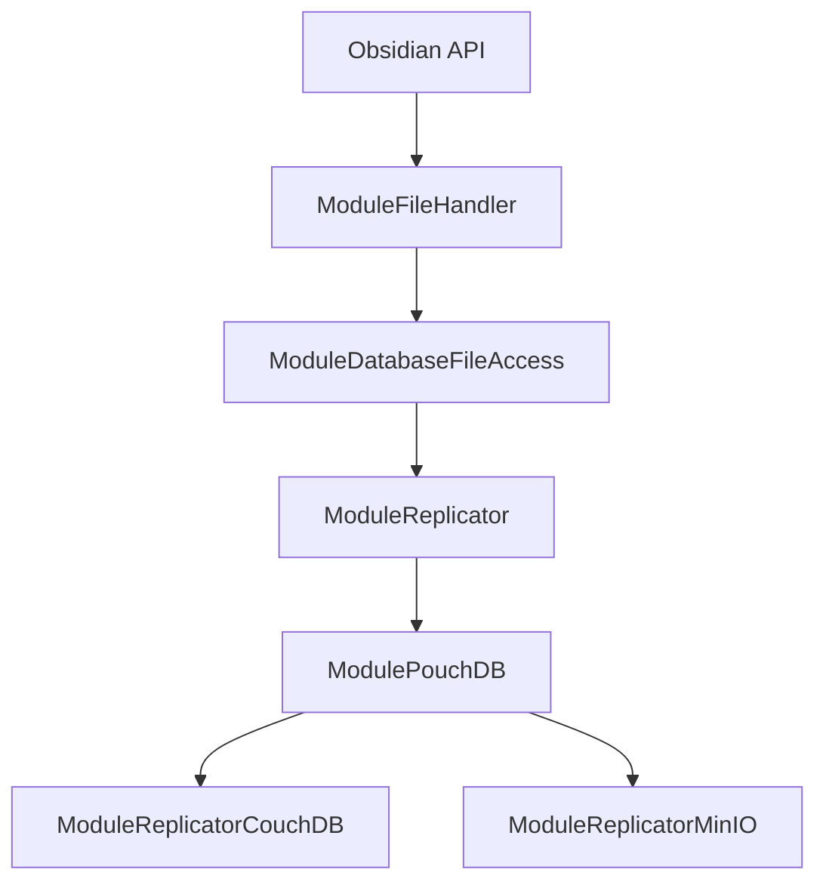

# vrtmrz/obsidian-livesync

> Extension Obsidian qui synchronise un coffre via CouchDB, stockage objet ou pair à pair WebRTC.

## Le problème
Obsidian Sync est payant et fermé ; il faut une synchronisation que tu héberges toi-même, chiffrée de bout en bout.

## Ce que ça fait vraiment
Synchronise les notes entre appareils avec CouchDB (temps réel), un stockage objet S3/R2/MinIO (périodique) ou WebRTC entre appareils (un relais de signalisation reste nécessaire). Fusionne les conflits simples, chiffre de bout en bout et synchronise paramètres, thèmes et extensions. Les connexions se partagent par un Setup URI chiffré.

## Comment c'est branché

## Essayer
Aucune commande dans le README : installer l'extension dans Obsidian, préparer un backend (Docker, Fly.io, IBM Cloudant, R2 ou S3), puis configurer le premier appareil et les suivants par Setup URI.

## Coût et pièges
Gratuit, mais tu opères ton serveur : exemple de ~2,34 USD par mois sur Fly.io, R2 gratuit dans ses quotas. Mobile : HTTPS obligatoire pour CouchDB. Sauvegarde du coffre avant installation.

## Ce que ce n'est pas
Incompatible avec Obsidian Sync ; ne pas l'activer avec iCloud ou un autre outil de synchronisation. Pas de synchronisation hors ligne en pair à pair.

## Alternatives
Aucune alternative nommée dans le README (il cite l'extension compagnon Differential ZIP Backup pour les sauvegardes).

## Pour toi
À surveiller : utile pour garder des notes de recherche privées et synchronisées, sous réserve d'assumer l'exploitation du serveur.

