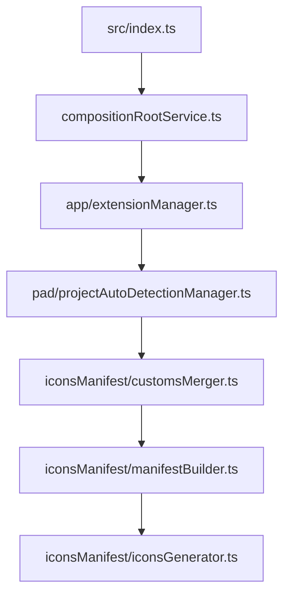

# vscode-icons/vscode-icons

> VS Code extension that shows icons by file and folder type, for any user of the editor.

## The problem
In the VS Code explorer, files all look alike and are hard to tell apart at a glance.

## What it actually does
The extension provides an icon theme. The code regenerates a theme manifest from file and folder associations, merges the user's customizations into it, and detects the project (Angular and other frameworks) to enable the right icon sets. Texts are translated through Crowdin.

## How it is wired


## Trying it
```bash
ext install vscode-icons
# ou, si l'extension est introuvable :
ext install icons
```
Type this in the VS Code command palette, then enable the icon theme.

## Cost and gotchas
Free and no key needed. After installation, you have to accept the activation prompt or pick the theme in the preferences.

## What it is not
Not a code analysis or code productivity tool: it is purely visual. It does not cover icons for every rare format.

## Alternatives
No alternative cited in the README (only the related projects vscode-icons-api and folder-icon-maker).

## For you
Adopt it if you work in VS Code (notebooks, project folders): a free readability gain, no risk.
