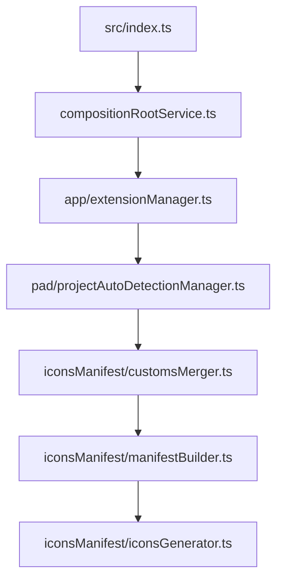

# vscode-icons/vscode-icons

> Extension VS Code qui affiche des icônes par type de fichier et de dossier, pour tout utilisateur de l'éditeur.

## Le problème
Dans l'explorateur de VS Code, les fichiers se ressemblent et on les repère mal d'un coup d'œil.

## Ce que ça fait vraiment
L'extension fournit un thème d'icônes. Le code régénère un manifeste de thème à partir des associations fichiers et dossiers, y fusionne les personnalisations de l'utilisateur, et détecte le projet (Angular et autres frameworks) pour activer les bons jeux d'icônes. Les textes sont traduits via Crowdin.

## Comment c'est branché


## Essayer
```bash
ext install vscode-icons
# ou, si l'extension est introuvable :
ext install icons
```
À taper dans la palette de commandes de VS Code, puis activer le thème d'icônes.

## Coût et pièges
Gratuit et sans clé. Après installation, il faut accepter l'activation ou choisir le thème dans les préférences.

## Ce que ce n'est pas
Pas un outil d'analyse ni de productivité de code : c'est purement visuel. Ne couvre pas les icônes de tous les formats rares.

## Alternatives
Aucune alternative citée dans le README (seulement les projets liés vscode-icons-api et folder-icon-maker).

## Pour toi
À adopter si tu travailles dans VS Code (notebooks, dossiers de projets) : gain de lisibilité gratuit, risque nul.

