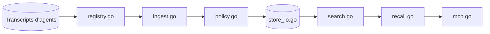

# vshulcz/deja-vu

> Local index that makes the history of all your coding agents searchable and recallable.

## The problem
Each agent (Claude Code, Codex, Cursor…) keeps its transcripts to itself and forgets from one session to the next; a solution found in one is lost to the others.

## What it actually does
Go binary that reads in place the JSONL and SQLite transcripts of 35 agents, masks recognized secrets and builds an incremental inverted index in `~/.cache/deja`.
Lexical search with no model or server; optional embeddings via Ollama, LM Studio or an OpenAI-compatible endpoint.
An MCP server (a single `deja` tool, with modes recall, context, blame, fix, how…) and hooks that inject the recall at session start, before an edit or after a failure.
CLI: `deja blame`, `deja fix`, `deja wip`, SSH sync between machines, `deja secrets --scrub`.

## How it is wired


## Trying it
```bash
curl -fsSL https://raw.githubusercontent.com/vshulcz/deja-vu/main/install.sh | sh
deja install --auto
deja "jwt refresh token"
deja doctor
deja uninstall --all
rm -rf ~/.cache/deja
```

## Cost and gotchas
Free and local; the network is only used for updates, SSH sync and embeddings if you configure them. `deja install --auto` writes instructions into the global file of each detected agent (`--no-guidance` to avoid this). Index on the order of 4 to 10% of the corpus.

## What it is not
Not secret detection: the masking relies on known patterns, an unknown form may slip through; the original transcripts keep their secrets.
Precision and token-savings figures are measured by the author, on his own benchmarks.
Windows is less proven than macOS and Linux.

## Alternatives
- engram: if you prefer a memory where the agent explicitly records its facts.
- Mem0 / Letta: memory platforms, capture by the agent and an LLM key required.
- cass: session search, without automatic recall.

## For you
Adopt if you juggle several coding agents: local, reversible, useful from day one.
