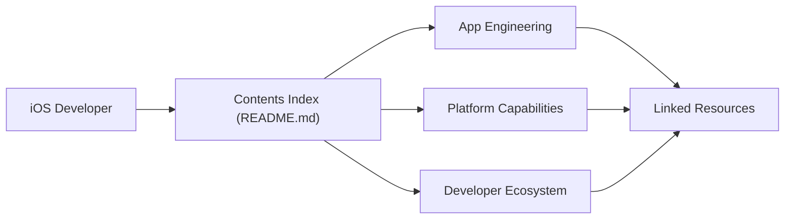

# vsouza/awesome-ios

> A categorized catalog of libraries, tools and resources for building iOS apps in Swift or Objective-C.

## The problem
The iOS ecosystem has thousands of scattered third-party libraries. Without an index, you don't know which building block exists for networking, caching or UI.

## What it actually does
A single README organized into about a hundred sections (Analytics, Networking, Database, Testing, Security, UI, Xcode…), each with links and a one-line description. No executable code: the only Swift sampled is an unrelated "hello". The list contains duplicates in the Image and Animation sections, and the "EventBus" section describes promise libraries (Promises/Futures).

## How it is wired

## Trying it
No documented command. You open the README and follow the links in the section you want.

## Cost and gotchas
Free, nothing to install. Beware: the list is very long, many entries are old (Swift 2/3, Objective-C) and nothing indicates which ones are still maintained.

## What it is not
It is neither a framework nor a comparison: no quality assessment, no ranking. Nor is it a reliable source of compatibility with recent iOS versions.

## Alternatives
- Swift Package Index (cited in the Tools section): gives quality and compatibility information per package.
- Awesome-Swift-Education (cited in Tutorials): for learning rather than hunting for a building block.

## For you
Ignore: this is Apple mobile development, outside the data/AI/MLOps scope; only the Machine Learning section (CoreML-Models, iOS-GenAI-Sampler, off-grid-mobile) touches your field.
