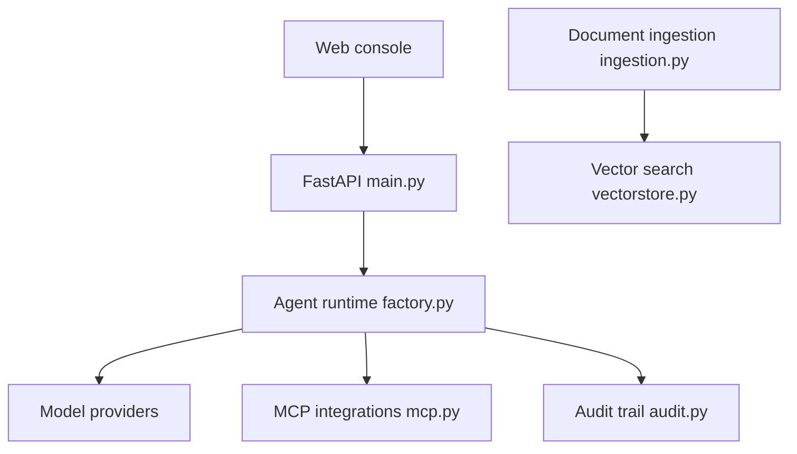

# vstorm-co/agenticos

> Self-hosted platform to build, share and govern AI agents as a team within a company.

## The problem
Agent frameworks are libraries: every behavior change requires a pull request, while the person who knows what to tell the agent has no access to the code.

## What it actually does
A web console (Next.js) and FastAPI API where an agent is configured in the browser: model, instructions, tools, MCP, skills, RAG bases (PostgreSQL and pgvector). Shared chat, budgets, approval policies, chained audit log, routines, visual workflows and publication of "apps". Agents can delegate code to Claude Code or Codex. 28 model providers are supported, including Ollama and vLLM.

## How it is wired



## Trying it
```bash
curl -fsSL https://raw.githubusercontent.com/vstorm-co/agenticos/main/scripts/quickstart.sh | bash -s -- --check
curl -fsSL https://raw.githubusercontent.com/vstorm-co/agenticos/main/scripts/quickstart.sh | bash
git clone --branch v1.38.2 --depth 1 https://github.com/vstorm-co/agenticos.git
bash scripts/server-init.sh
```

## Cost and gotchas
A host with 4 vCPU and 8 GB of RAM, Docker 24+, two DNS names for a production server. Model, infrastructure and maintenance costs are at your expense. Back up the database and the vault key in `backend/.env`.

## What it is not
Not a framework: it is a product layer. The native mobile apps are only development builds, and the one-click hosting templates are maintained separately.

## Alternatives
No alternative named in the README.

## For you
Worth watching: covers RAG, budgets and audit for internal agents, but the scope is broad and requires operations work.
