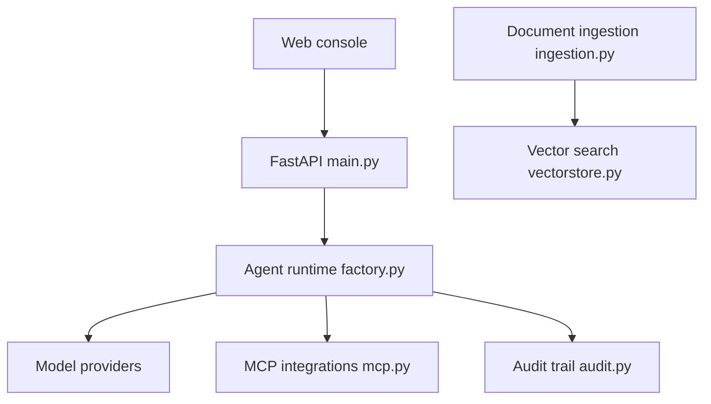

# vstorm-co/agenticos

> Plateforme auto-hébergée pour construire, partager et gouverner des agents IA en équipe dans une entreprise.

## Le problème
Les frameworks d'agents sont des bibliothèques : chaque changement de comportement exige une pull request, alors que la personne qui sait quoi dire à l'agent n'a pas accès au code.

## Ce que ça fait vraiment
Console web (Next.js) et API FastAPI où l'on configure un agent dans le navigateur : modèle, instructions, outils, MCP, compétences, bases RAG (PostgreSQL et pgvector). Chat partagé, budgets, politiques d'approbation, journal d'audit chaîné, routines, workflows visuels et publication d'« apps ». Les agents peuvent déléguer du code à Claude Code ou Codex. 28 fournisseurs de modèles sont pris en charge, dont Ollama et vLLM.

## Comment c'est branché



## Essayer
```bash
curl -fsSL https://raw.githubusercontent.com/vstorm-co/agenticos/main/scripts/quickstart.sh | bash -s -- --check
curl -fsSL https://raw.githubusercontent.com/vstorm-co/agenticos/main/scripts/quickstart.sh | bash
git clone --branch v1.38.2 --depth 1 https://github.com/vstorm-co/agenticos.git
bash scripts/server-init.sh
```

## Coût et pièges
Hôte de 4 vCPU et 8 Go de RAM, Docker 24+, deux noms DNS pour un serveur de production. Coûts de modèles, d'infrastructure et de maintenance à ta charge. Sauvegarder la base et la clé du coffre dans `backend/.env`.

## Ce que ce n'est pas
Pas un framework : c'est une couche produit. Les apps mobiles natives ne sont que des builds de développement, et les modèles d'hébergement en un clic sont maintenus à part.

## Alternatives
Aucune alternative nommée dans le README.

## Pour toi
À surveiller : couvre RAG, budgets et audit pour des agents internes, mais le périmètre est large et demande de l'exploitation.

