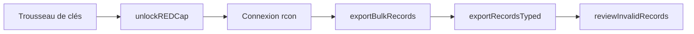

# vubiostat/redcapAPI

> R package that extracts analysis-ready data from a REDCap project, with typing and validation.

## The problem
Raw exports from the REDCap API require a lot of cleaning, typing and error handling before analysis.

## What it actually does
Unlocks the API key via a local keyring, retries with exponential backoff, caches metadata, applies overridable typing (missing values, validation, conversion) and splits forms. `reviewInvalidRecords` reports invalid data. Import reuses these functions in reverse.

## How it is wired
Simplified diagram based on the sheet, no diagram provided.



## Trying it
```r
library(redcapAPI)
unlockREDCap(c(rcon = '<MY PROJECT NAME>'), keyring = 'API_KEYs', envir = globalenv(), url = 'https://<REDCAP_URL>/api/')
exportBulkRecords(list(db = rcon), forms = list(db = unique(rcon$metadata()$form_name)), envir = globalenv())
```

## Cost and gotchas
Free. Requires a REDCap instance and an API token. Designed for REDCap 14+: some functions may be missing on older versions. `exportRecords` is slated for removal.

## What it is not
Not a thin API client: no tidy/tibble support according to the comparison table.

## Alternatives
REDCapR, tidyREDCap, REDCapTidieR, REDCapDM (cited in the README table).

## For you
Worth watching: solid if your clinical data lives in REDCap, otherwise irrelevant.
