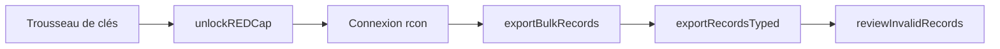

# vubiostat/redcapAPI

> Paquet R qui extrait des données d'un projet REDCap prêtes à analyser, avec typage et validation.

## Le problème
Les exports bruts de l'API REDCap exigent beaucoup de nettoyage, de typage et de gestion d'erreurs avant analyse.

## Ce que ça fait vraiment
Déverrouille la clé d'API via un trousseau local, relance avec attente exponentielle, met en cache les métadonnées, applique un typage surchargeable (valeurs manquantes, validation, conversion) et découpe les formulaires. `reviewInvalidRecords` rapporte les données invalides. L'import réutilise ces fonctions en sens inverse.

## Comment c'est branché
Schéma simplifié d'après la fiche, sans diagramme fourni.



## Essayer
```r
library(redcapAPI)
unlockREDCap(c(rcon = '<MY PROJECT NAME>'), keyring = 'API_KEYs', envir = globalenv(), url = 'https://<REDCAP_URL>/api/')
exportBulkRecords(list(db = rcon), forms = list(db = unique(rcon$metadata()$form_name)), envir = globalenv())
```

## Coût et pièges
Gratuit. Exige une instance REDCap et un jeton d'API. Conçu pour REDCap 14+ : certaines fonctions peuvent manquer sur des versions plus anciennes. `exportRecords` doit disparaître.

## Ce que ce n'est pas
Pas un client mince de l'API : pas de support tidy/tibble selon le tableau comparatif.

## Alternatives
REDCapR, tidyREDCap, REDCapTidieR, REDCapDM (cités dans le tableau du README).

## Pour toi
À surveiller : solide si tes données cliniques sont dans REDCap, sinon sans objet.

