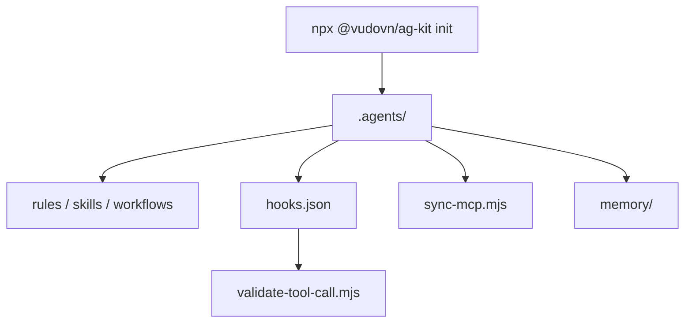

# vudovn/ag-kit

> Agent engineering kit for Google Antigravity: rules, skills, specialist agents and a security hook.

## The problem
A coding agent without shared rules or memory drifts from one session to the next and can run destructive commands.

## What it actually does
README identical to that of vudovn/antigravity-kit (same metadata: 8,209 stars, created 2026-01-14): a `.agents/` workspace with 20 agents, 47 skills, 13 workflows, 6 rules, persistent memory and a `PreToolUse` hook that blocks obviously destructive commands.

## How it is wired

Simplified diagram: the README provides no diagram.

## Trying it
```bash
npx @vudovn/ag-kit init
npm run check:agents
npm run check:antigravity
npm run test:antigravity
```

## Cost and gotchas
Free. Node 22+ for the repo's tooling, Python 3.10+, a trusted Antigravity workspace. Replace `YOUR_API_KEY` in the MCP example before the doctor's strict mode.

## What it is not
The same repo as vudovn/antigravity-kit under another name (probable duplicate, rename redirect): do not count it twice. It only serves Antigravity and does not replace the sandbox.

## Alternatives
No alternative named in the README.

## For you
Worth watching, like its duplicate: useful only if you use Antigravity; the Markdown skills remain reusable elsewhere.
