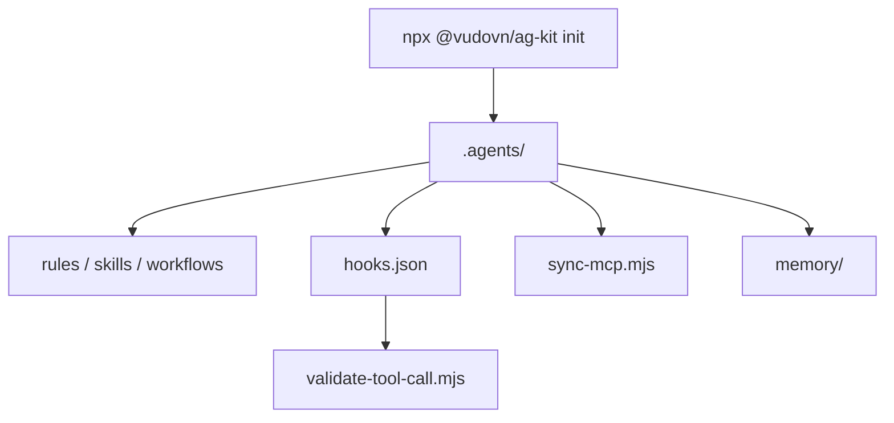

# vudovn/ag-kit

> Kit d'ingénierie d'agents pour Google Antigravity : règles, skills, agents spécialistes et hook de sécurité.

## Le problème
Un agent de code sans règles ni mémoire commune dérive d'une session à l'autre et peut lancer des commandes destructrices.

## Ce que ça fait vraiment
README identique à celui de vudovn/antigravity-kit (mêmes métadonnées : 8 209 étoiles, créé le 2026-01-14) : espace `.agents/` avec 20 agents, 47 skills, 13 workflows, 6 règles, mémoire persistante et hook `PreToolUse` qui bloque les commandes destructrices évidentes.

## Comment c'est branché

Schéma simplifié : le README ne fournit pas de diagramme.

## Essayer
```bash
npx @vudovn/ag-kit init
npm run check:agents
npm run check:antigravity
npm run test:antigravity
```

## Coût et pièges
Gratuit. Node 22+ pour les outils du dépôt, Python 3.10+, espace Antigravity de confiance. Remplacer `YOUR_API_KEY` dans l'exemple MCP avant le mode strict du doctor.

## Ce que ce n'est pas
Le même dépôt que vudovn/antigravity-kit sous un autre nom (doublon probable, redirection de renommage) : ne pas le compter deux fois. Il ne sert qu'Antigravity et ne remplace pas la sandbox.

## Alternatives
Aucune alternative nommée dans le README.

## Pour toi
À surveiller, comme son doublon : utile seulement si tu utilises Antigravity ; les skills Markdown restent réutilisables ailleurs.

