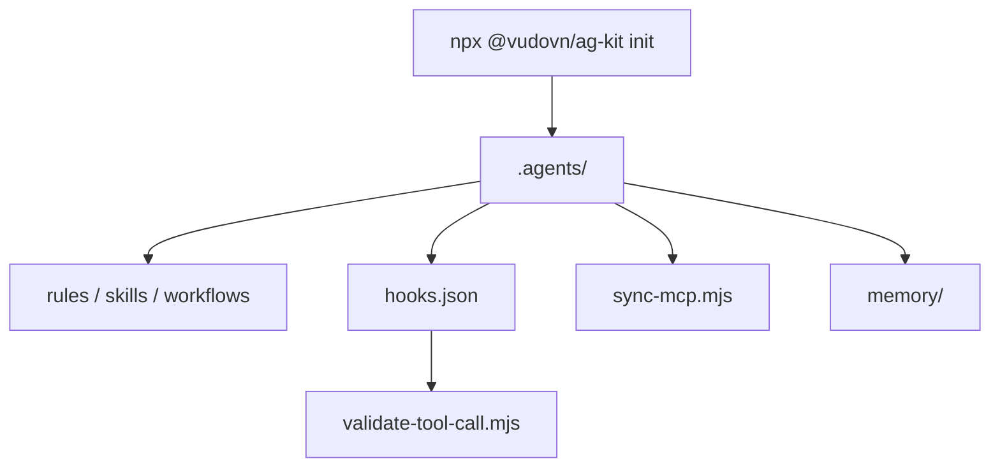

# vudovn/antigravity-kit

> Agent engineering kit for Google Antigravity: rules, skills, specialist agents and a security hook.

## The problem
A coding agent without shared rules or memory drifts from one session to the next and can run destructive commands.

## What it actually does
Installs a `.agents/` workspace: 20 agents, 47 skills, 13 workflows (`/plan`, `/orchestrate`, `/verify`…), 6 rules and persistent memory. A `PreToolUse` hook blocks obviously destructive commands (deleting the root, formatting). A script synchronizes the MCP configuration with a backup.

## How it is wired

Simplified diagram: the README provides no diagram.

## Trying it
```bash
npx @vudovn/ag-kit init
npm run check:agents
npm run check:antigravity
npm run build:antigravity-plugin
```

## Cost and gotchas
Free. Node 22+ is needed for the repo's tooling (CLI: Node 18+), Python 3.10+, and a trusted Antigravity workspace. The MCP example contains `YOUR_API_KEY` to replace. Do not ignore `.agents/` in `.gitignore`.

## What it is not
The only supported runtime is Antigravity. The hook is deliberately narrow and replaces neither permissions, nor a sandbox, nor human validation. The repo also appears under the name vudovn/ag-kit with an identical README.

## Alternatives
No alternative named in the README.

## For you
Worth watching: interesting if you work in Antigravity; outside that tool, only the Markdown content (skills, rules) is reusable.
