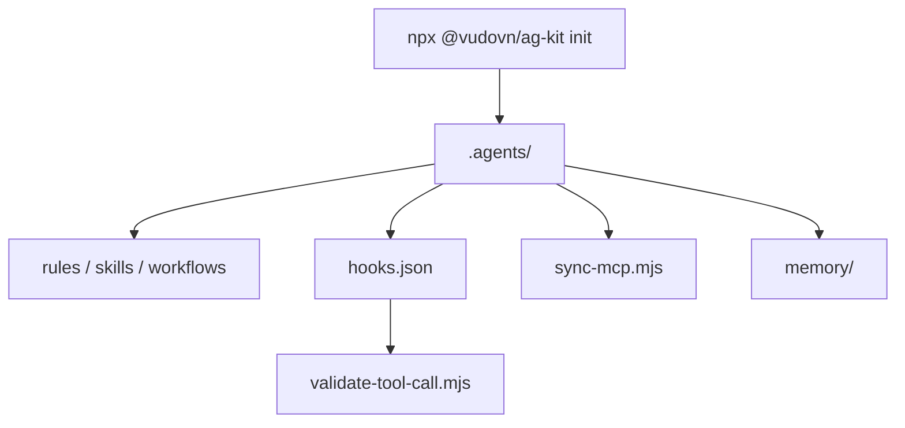

# vudovn/antigravity-kit

> Kit d'ingénierie d'agents pour Google Antigravity : règles, skills, agents spécialistes et hook de sécurité.

## Le problème
Un agent de code sans règles ni mémoire commune dérive d'une session à l'autre et peut lancer des commandes destructrices.

## Ce que ça fait vraiment
Installe un espace `.agents/` : 20 agents, 47 skills, 13 workflows (`/plan`, `/orchestrate`, `/verify`…), 6 règles et une mémoire persistante. Un hook `PreToolUse` bloque les commandes destructrices évidentes (suppression de la racine, formatage). Un script synchronise la configuration MCP avec sauvegarde.

## Comment c'est branché

Schéma simplifié : le README ne fournit pas de diagramme.

## Essayer
```bash
npx @vudovn/ag-kit init
npm run check:agents
npm run check:antigravity
npm run build:antigravity-plugin
```

## Coût et pièges
Gratuit. Il faut Node 22+ pour les outils du dépôt (CLI : Node 18+), Python 3.10+, et un espace Antigravity de confiance. L'exemple MCP contient `YOUR_API_KEY` à remplacer. Ne pas ignorer `.agents/` dans le `.gitignore`.

## Ce que ce n'est pas
Le runtime supporté est Antigravity uniquement. Le hook est volontairement étroit et ne remplace ni permissions, ni sandbox, ni validation humaine. Le dépôt apparaît aussi sous le nom vudovn/ag-kit avec un README identique.

## Alternatives
Aucune alternative nommée dans le README.

## Pour toi
À surveiller : intéressant si tu travailles dans Antigravity ; hors de cet outil, seul le contenu Markdown (skills, règles) est réutilisable.

