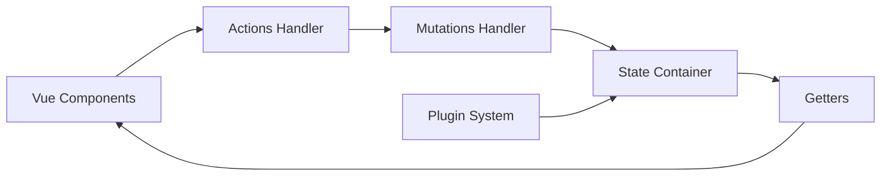

# vuejs/vuex

> Centralized state management library for Vue.js, now superseded by Pinia.

## The problem
In a Vue app, sharing and modifying state across components predictably quickly becomes unmanageable without a convention.

## What it actually does
A centralized store (state, getters, synchronous mutations, asynchronous actions, modules) with plugins and integration with the Vue devtools for time-travel debugging. The README announces that Pinia is the new default choice; Vuex 3 and 4 are still maintained but without new features.

## How it is wired


## Trying it
```bash
npm install
npm run dev
```
(README commands to serve the examples on localhost:8080)

## Cost and gotchas
Free. Last push on 2024-09-25, more than a year ago; the README recommends Pinia for any new project.

## What it is not
It is no longer the recommended choice to get started. It is not a tool outside the Vue ecosystem.

## Alternatives
- Pinia: official successor, API close to Vuex 5, also works with Vue 2.

## For you
Ignore: front-end library in maintenance-only mode, unrelated to your field; if you do Vue, use Pinia.
