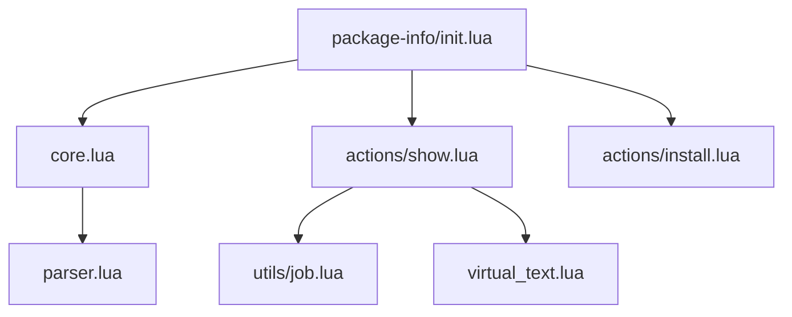

# vuki656/package-info.nvim

> Neovim plugin that shows the latest dependency versions in `package.json` and drives npm, yarn, pnpm, bun.

## The problem
Checking and changing dependency versions forces you to leave the editor to type commands.

## What it actually does
Runs `npm outdated --json` in the background and compares with `package.json`; versions are displayed as virtual text (one-hour cache). Commands to update, delete, install or change the version of the current line. Detects the package manager through the lock file. Optional Telescope extension.

## How it is wired


## Trying it
```lua
use({ "vuki656/package-info.nvim", requires = "MunifTanjim/nui.nvim" })
require('package-info').setup()
vim.keymap.set({ "n" }, "<leader>ns", "<cmd>PackageInfoShow<cr>", { silent = true, noremap = true })
```

## Cost and gotchas
Free. Neovim 0.9+ and npm required. GPL-3.0 license (copyleft). Display can be slow with many dependencies.

## What it is not
It is not a security tool or a package manager: it calls yours. No default key bindings.

## Alternatives
- dependency-assist.nvim: source of inspiration cited in the README.

## For you
Ignore: useful for JS projects under Neovim, not for a data / AI profile centered on Python.
