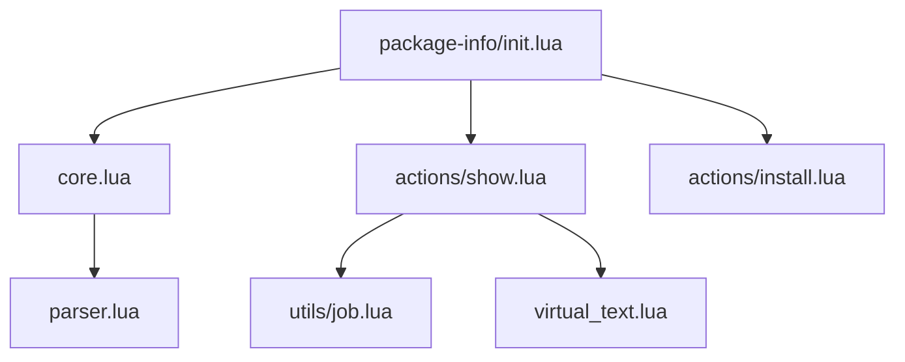

# vuki656/package-info.nvim

> Plugin Neovim qui affiche les dernières versions des dépendances dans `package.json` et pilote npm, yarn, pnpm, bun.

## Le problème
Vérifier et changer des versions de dépendances oblige à quitter l'éditeur pour taper des commandes.

## Ce que ça fait vraiment
Lance `npm outdated --json` en tâche de fond et compare avec `package.json` ; les versions s'affichent en texte virtuel (cache d'une heure). Commandes pour mettre à jour, supprimer, installer ou changer la version de la ligne courante. Détecte le gestionnaire de paquets via le fichier de verrouillage. Extension Telescope en option.

## Comment c'est branché


## Essayer
```lua
use({ "vuki656/package-info.nvim", requires = "MunifTanjim/nui.nvim" })
require('package-info').setup()
vim.keymap.set({ "n" }, "<leader>ns", "<cmd>PackageInfoShow<cr>", { silent = true, noremap = true })
```

## Coût et pièges
Gratuit. Neovim 0.9+ et npm requis. Licence GPL-3.0 (copyleft). L'affichage peut être lent sur beaucoup de dépendances.

## Ce que ce n'est pas
Ce n'est pas un outil de sécurité ni un gestionnaire de paquets : il appelle les vôtres. Sans touches par défaut.

## Alternatives
- dependency-assist.nvim : source d'inspiration citée dans le README.

## Pour toi
À ignorer : utile pour des projets JS sous Neovim, pas pour un profil data / IA centré sur Python.

