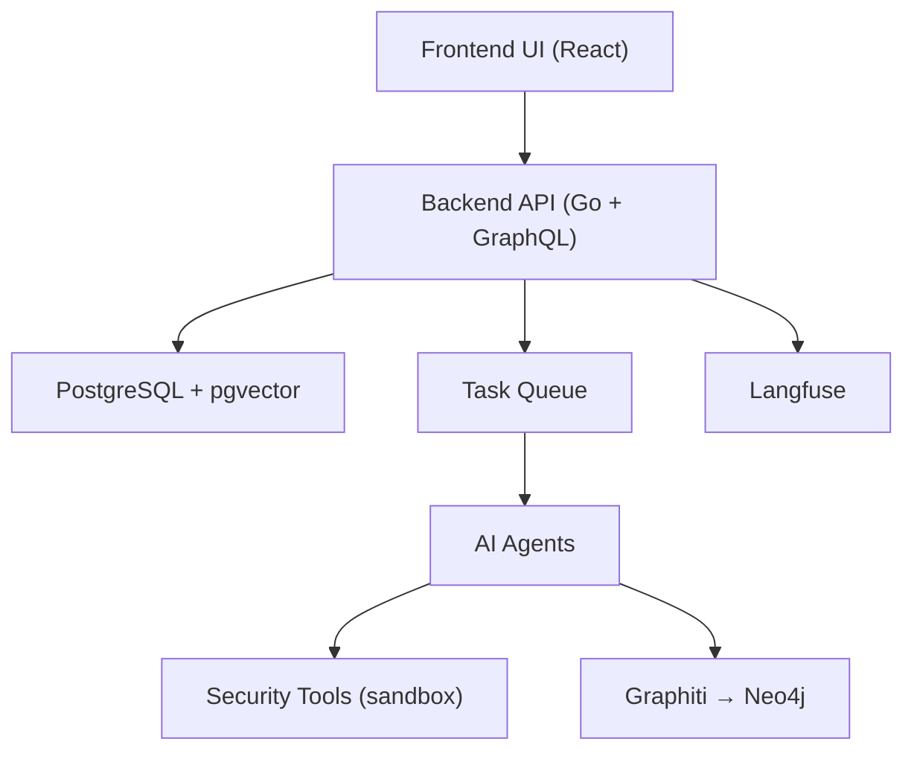

# vxcontrol/pentagi

> Autonomous penetration-testing platform driven by LLM agents, for security professionals.

## The problem
A penetration test chains dozens of tools and decisions; the chaining is manual,
not replayable, and the results of one campaign do not serve the next.

## What it actually does
A multi-agent system (Orchestrator, Researcher, Developer, Executor, Adviser, Reflector, Planner)
that runs security tools in isolated Docker containers, stores its observations in
PostgreSQL + pgvector, and produces vulnerability reports. Two beta mechanisms support
small models: Execution Monitoring (`EXECUTION_MONITOR_ENABLED`) and Task Planning
(`AGENT_PLANNING_STEP_ENABLED`). Hard caps on tool calls are always active.

## How it is wired


## Trying it
```bash
mkdir -p pentagi && cd pentagi
wget -O installer.zip https://pentagi.com/downloads/linux/amd64/installer-latest.zip
unzip installer.zip
./installer
```

## Cost and gotchas
Minimum 2 vCPU, 4 GB of RAM, 20 GB of disk, plus a key from one of the 10+ supported LLM
providers. Monitoring and planning multiply token consumption and execution
time by 2 to 3, for a claimed quality gain of ×2 on Qwen3.5-27B-FP8. No license in the README.

## What it is not
The README itself bounds the scope: it is not an attack simulation product like CALDERA,
no predefined campaigns; attack scripts written by the agent belong to the future, not the present.
The JSON export of the flow report is not documented. The README is truncated before the end of the installation.

## Alternatives
- CALDERA: named in the README as the BAS category that PentAGI does not cover.

## For you
Outside your data/MLOps focus, except as a textbook case of a supervised multi-agent architecture.
