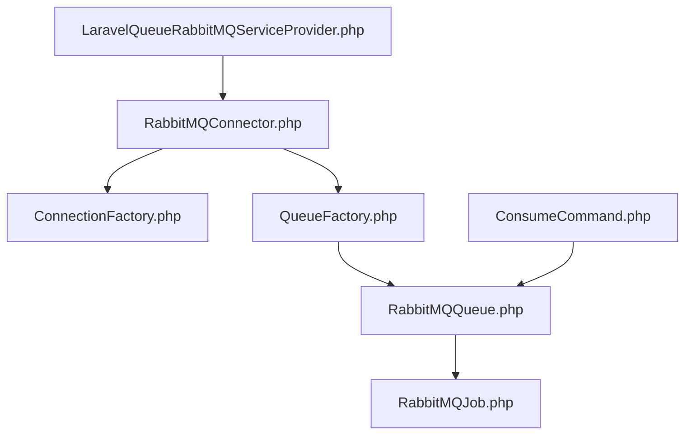

# vyuldashev/laravel-queue-rabbitmq

> RabbitMQ queue driver for Laravel and Lumen queues.

## The problem
Laravel offers job queues but not RabbitMQ natively, with its exchanges, routing keys and priorities.

## What it actually does
Adds a `rabbitmq` connection to `config/queue.php`: exchanges and routing keys, priorities, rerouting of failed jobs, customizable job, connection and worker classes, SSL, heartbeats, network timeouts, after-commit events. Two consumption modes: `queue:work` (basic_get) and `rabbitmq:consume` (basic_consume, about twice as fast, a single queue).

## How it is wired


## Trying it
```bash
composer require vladimir-yuldashev/laravel-queue-rabbitmq
docker compose up -d
composer test
```

## Cost and gotchas
Free, but requires a RabbitMQ server to host and PHP/Composer. Some configuration examples in the README contain syntax errors (`'connection' = >`) that need fixing.

## What it is not
Not a messaging service: it plugs into an existing RabbitMQ. Outside Laravel and Lumen, it is of no interest.

## Alternatives
No alternative named in the README.

## For you
Ignore: a PHP driver for Laravel, unrelated to your data/AI/MLOps stack.
