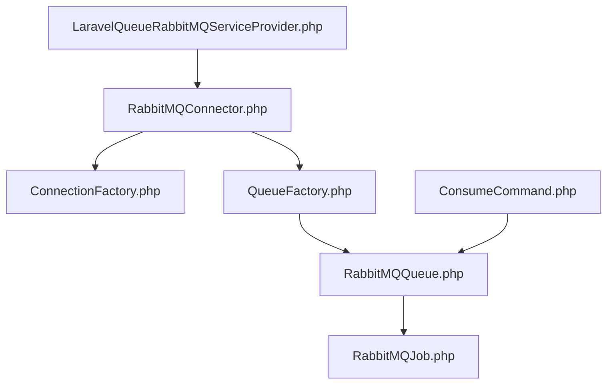

# vyuldashev/laravel-queue-rabbitmq

> Pilote de files RabbitMQ pour les files d'attente de Laravel et Lumen.

## Le problème
Laravel propose des files de tâches mais pas RabbitMQ en natif, avec ses échanges, clés de routage et priorités.

## Ce que ça fait vraiment
Ajoute une connexion `rabbitmq` à `config/queue.php` : échanges et clés de routage, priorités, réacheminement des tâches échouées, classes de job, de connexion et de worker personnalisables, SSL, battements de cœur, délais réseau, événements après commit. Deux modes de consommation : `queue:work` (basic_get) et `rabbitmq:consume` (basic_consume, environ deux fois plus rapide, une seule file).

## Comment c'est branché


## Essayer
```bash
composer require vladimir-yuldashev/laravel-queue-rabbitmq
docker compose up -d
composer test
```

## Coût et pièges
Gratuit, mais exige un serveur RabbitMQ à héberger et PHP/Composer. Certains exemples de configuration du README contiennent des erreurs de syntaxe (`'connection' = >`) à corriger.

## Ce que ce n'est pas
Pas un service de messagerie : il se branche sur un RabbitMQ existant. Hors Laravel et Lumen, aucun intérêt.

## Alternatives
Aucune alternative nommée dans le README.

## Pour toi
À ignorer : pilote PHP pour Laravel, sans lien avec ta pile data/IA/MLOps.

