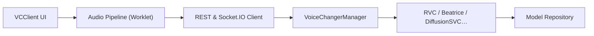

# w-okada/voice-changer

> Real-time AI voice conversion software (VCClient), for changing your voice on the fly.

## The problem
Convert your voice live with an AI model, without having to load a game or a video call.

## What it actually does
A web or desktop client (React/TypeScript) connected either to a local module or to a Python server (REST and Socket.IO) that loads conversion models (RVC, Beatrice, and others in v1: MMVC, so-vits-svc, DDSP-SVC). Network mode delegates the computation to another machine. Editions per platform: `std` (Beatrice) and `cuda`/`onnx` (Beatrice and RVC). A REST API is provided. The README is in Japanese, machine-translated.

## How it is wired

## Trying it
No command is documented: the README points to the Hugging Face downloads (Windows, Mac M1) and asks you to clone the repository for Linux.

## Cost and gotchas
Free. `cuda` edition for Windows with RVC. The software is not signed (macOS warning, run at your own risk). A license is present but not identified by GitHub; the voice models (Tsukuyomi-chan, Amitaro, etc.) each have strict terms of use, listed in the README.

## What it is not
Not a complete training tool (the repository points to other repositories for Beatrice v2). Version 2.2.2 is still in beta.

## Alternatives
No alternative is cited in the README.

## For you
Ignore: a niche application, in beta, with an unclear license and restricted uses; not a building block for an AI pipeline.
