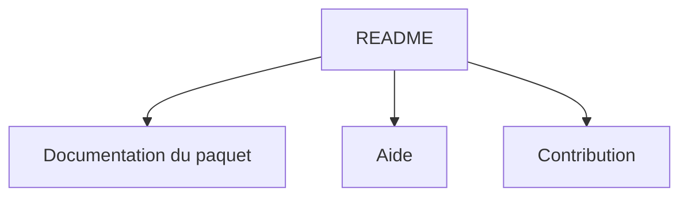

# wadpac/GGIR

> R package for processing accelerometer data, judging by the name; the README does not say so.

## The problem
Not documented in the README provided.

## What it actually does
The README only covers the documentation, help and contributions. Nothing about the functions. It only states that the logo belongs to Accelting.

## How it is wired
Simplified diagram based on the sheet, no diagram provided.



## Trying it
```bash
# Aucune commande documentée dans le README
```

## Cost and gotchas
Not documented. Free (Apache-2.0). The logo is subject to authorization.

## What it is not
A repository whose README is a mere pointer to external pages: nothing can be verified here.

## Alternatives
None cited in the README.

## For you
Ignore: insufficient material to decide, and the domain (accelerometer data) is far from a data / AI / MLOps profile.
