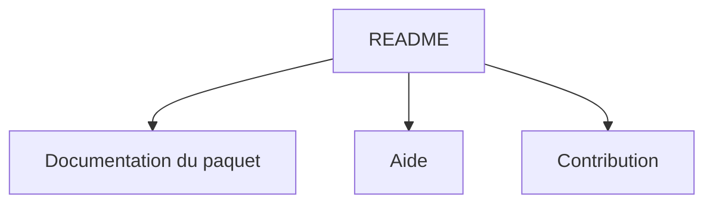

# wadpac/GGIR

> Paquet R de traitement de données d'accéléromètres, d'après le nom ; le README ne le dit pas.

## Le problème
Non documenté dans le README fourni.

## Ce que ça fait vraiment
Le README ne décrit que la documentation, l'aide et les contributions. Rien sur les fonctions. Il précise seulement que le logo appartient à Accelting.

## Comment c'est branché
Schéma simplifié d'après la fiche, sans diagramme fourni.



## Essayer
```bash
# Aucune commande documentée dans le README
```

## Coût et pièges
Non documenté. Gratuit (Apache-2.0). Le logo est soumis à autorisation.

## Ce que ce n'est pas
Un dépôt dont le README est un simple renvoi vers des pages externes : rien n'est vérifiable ici.

## Alternatives
Aucune citée dans le README.

## Pour toi
Ignorer : matière insuffisante pour trancher, et le domaine (données d'accéléromètres) est éloigné d'un profil data / IA / MLOps.

