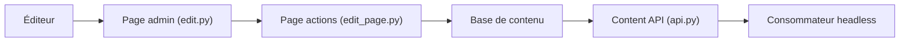

# wagtail/wagtail

> Open source CMS built on Django, for teams that publish editorial content.

## The problem
Publishing and reviewing pages requires an editing interface, permissions, revisions and an API, which Django alone does not provide.

## What it actually does
Admin interface for authors, StreamField for flexible content, approval workflows, search (Elasticsearch or PostgreSQL), images, documents, snippets, multilingual, redirects, front-end cache invalidation and a content API for "headless" sites. The README announces support for Django 5.2 to 6.1, Python 3.11 to 3.14 and PostgreSQL, MySQL, MariaDB or SQLite. A release comes out every three months.

## How it is wired


## Trying it
```bash
pip install wagtail
wagtail start mysite
cd mysite
pip install -r requirements.txt
python manage.py migrate
python manage.py createsuperuser
python manage.py runserver
```

## Cost and gotchas
Free; commercial support exists separately. A Python 3 virtual environment is required. About 1,000 open issues. Nightly builds are available but not stable.

## What it is not
Not a data tool: it is a content management system. The architecture description specifies that some internal sequences are not established.

## Alternatives
No alternative cited in the README.

## For you
Ignore: a Django CMS unrelated to AI or MLOps, unless you have to publish documentation or an editorial site.
