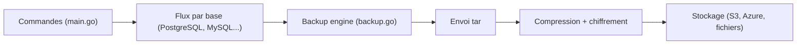

# wal-g/wal-g

> Archiving and restore tool for databases (PostgreSQL, MySQL, SQL Server) to object storage.

## The problem
Backing up and restoring large databases, with continuous WAL archiving, is slow and expensive without compression and parallelism.

## What it actually does
Successor to WAL-E, written in Go. Per-database commands (`backup-push`, `backup-fetch`, `backup-list`, `delete`, and WAL commands for Postgres); compressed (LZ4, LZMA, ZSTD, Brotli) and encrypted (libsodium, OpenPGP, Yandex KMS) backups, S3, Azure or filesystem storage, statsd metrics, rate limiting. Beta support for MongoDB and Redis, Greenplum/Cloudberry "production ready", etcd and FoundationDB in progress.

## How it is wired


## Trying it
```bash
tar -zxvf wal-g-pg-24.04-amd64.tar.gz
mv wal-g-pg-24.04-amd64 /usr/local/bin/wal-g
wal-g backup-list --pretty
wal-g delete retain FULL 5 --confirm
```

## Cost and gotchas
Free; object storage is at your expense. `delete` does a dry run without `--confirm`. After a major Postgres version upgrade, `retain` may delete new backups: use `--use-sentinel-time`. Apache license announced but LZO support is under GPL 3.0; GitHub does not identify it. 320 open issues.

## What it is not
Not a replication or high-availability tool. The "beta" engines are not suited to critical data without validation.

## Alternatives
WAL-E (predecessor cited in the README).

## For you
Keep an eye on it if your warehouse or feature store is PostgreSQL or MySQL: a good candidate for backups and point-in-time restore; test the restore before trusting it.
