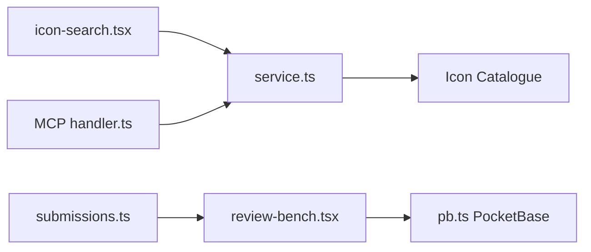

# walkxcode/dashboard-icons

> Collection of over 1800 service and application icons for dashboards, in SVG, PNG and WEBP.

## The problem
Dashboards and application directories need consistent icons, with light and dark variants.

## What it actually does
Serves the icons via CDN (jsDelivr) or GitHub following `<Base URL>/<Format>/<Name>.<Format>`, with `-light` and `-dark` suffixes. A site (dashboardicons.com) lets you search, submit and have icons reviewed (PocketBase), indexes external icons (Simple Icons) and exposes an MCP server.

## How it is wired


## Trying it
```bash
curl -O https://cdn.jsdelivr.net/gh/homarr-labs/dashboard-icons/svg/nextcloud.svg
wget https://cdn.jsdelivr.net/gh/homarr-labs/dashboard-icons/svg/nextcloud.svg
```

## Cost and gotchas
Free. Brands and logos remain the property of their owners; Simple Icons icons (CC0) do not lift trademark restrictions. The README mentions `homarr-labs`: the repository has been transferred.

## What it is not
Not a generic icon library: specific to self-hosted services. Brand icons are not free for any use.

## Alternatives
- Simple Icons: indexed via a colorable proxy, CC0 collection.

## For you
Worth watching: handy for an internal portal or an MLOps dashboard, with no technical stakes; check the brand rules.
