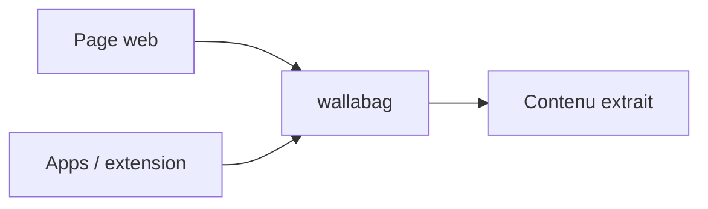

# wallabag/wallabag

> Self-hostable web application for saving pages and reading them later without distraction.

## The problem
Reading web articles later without pop-ups, without depending on a closed service.

## What it actually does
Saves a page and extracts its content for a clean reading view. Installable on your own server, or use an account on wallabag.it. Ecosystem: Android and iOS apps, a browser extension, docs in `doc/`. Translation through Weblate.

## How it is wired
No diagram provided.


## Trying it
```bash
git clone https://github.com/wallabag/wallabag.git
cd wallabag && make install
# puis configurer un virtual host
```

## Cost and gotchas
Self-host: web server and prerequisites listed in the docs (not detailed in the README). Hosted: a wallabag.it account.

## What it is not
Not an automatic watch tool nor an advanced full-text search tool. The name is written entirely in lowercase, and the README insists on it.

## Alternatives
No alternative named.

## For you
Keep an eye on it: useful for your personal reading list, with no link to the data/AI pipeline.
