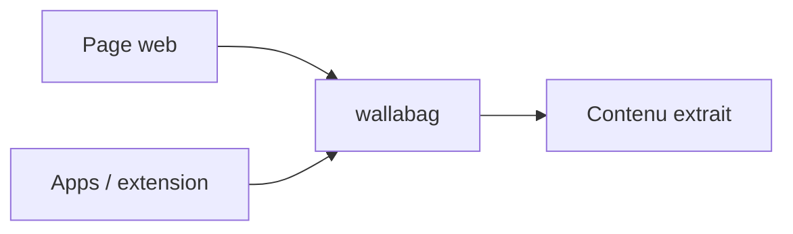

# wallabag/wallabag

> Application web auto-hébergeable pour sauvegarder des pages et les lire plus tard sans distraction.

## Le problème
Lire plus tard des articles web sans pop-ups, sans dépendre d'un service fermé.

## Ce que ça fait vraiment
Enregistre une page et en extrait le contenu pour une lecture épurée. Installable sur ton serveur, ou compte sur wallabag.it. Écosystème : apps Android et iOS, extension de navigateur, doc dans `doc/`. Traduction via Weblate.

## Comment c'est branché
Pas de diagramme fourni.


## Essayer
```bash
git clone https://github.com/wallabag/wallabag.git
cd wallabag && make install
# puis configurer un virtual host
```

## Coût et pièges
Self-host : serveur web et prérequis listés dans la doc (non détaillés dans le README). Hébergé : compte wallabag.it.

## Ce que ce n'est pas
Pas un outil de veille automatique ni de recherche plein texte avancée. Le nom s'écrit tout en minuscules, le README y tient.

## Alternatives
Aucune alternative nommée.

## Pour toi
Surveiller : utile pour ta veille de lecture perso, sans lien avec le pipeline data/IA.

