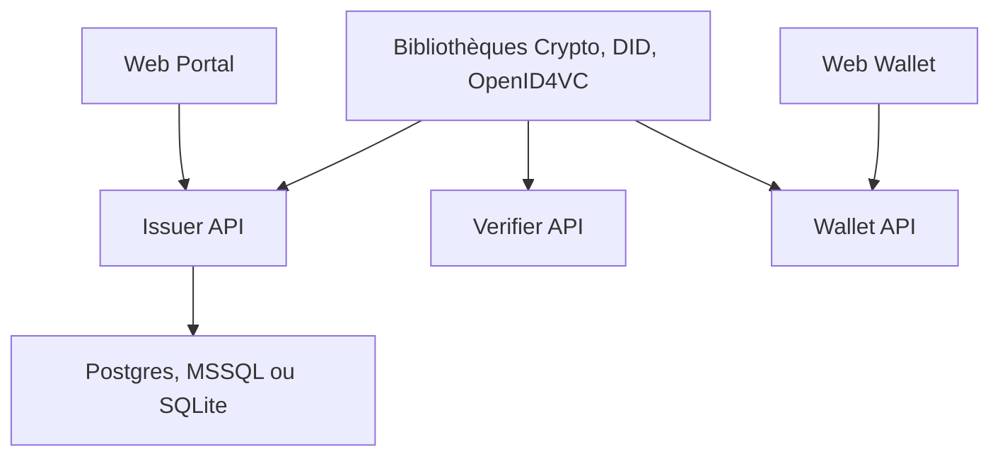

# walt-id/waltid-identity

> Community edition of walt.id: issue, hold and verify digital credentials (VC, mdoc, EUDI).

## The problem
Setting up issuance, wallet and verification of digital credentials compliant with open standards is slow without ready-made building blocks.

## What it actually does
Kotlin Multiplatform monorepo: libraries (crypto, DID, W3C credentials, mdoc, SD-JWT, OpenID4VCI and OpenID4VP), REST services (issuer, verifier, wallet) and applications (web portal, web wallet, CLI, mobile examples). Docker Compose launches everything. A paid enterprise edition exists alongside.

## How it is wired


## Trying it
```bash
git clone https://github.com/walt-id/waltid-identity.git && cd waltid-identity
cd docker-compose && docker compose up
```

## Cost and gotchas
Docker and Docker Compose. The services are self-managed: database, vault and reverse proxy are your responsibility. The old `waltid-*-api` v1 family is slated for deprecation in favor of v2.

## What it is not
Not the enterprise edition: the comparison is deferred to a page on the website. The demo instances are for testing only, not for production.

## Alternatives
No alternative named in the README.

## For you
Keep an eye on it: useful if a digital identity or EUDI wallet project appears; otherwise outside your data / AI scope.
