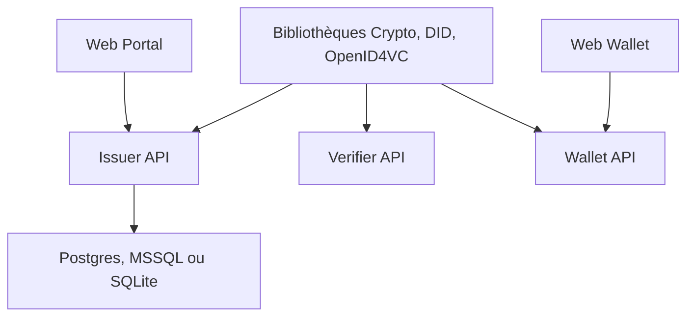

# walt-id/waltid-identity

> Édition communautaire de walt.id : émettre, détenir et vérifier des identifiants numériques (VC, mdoc, EUDI).

## Le problème
Mettre en place émission, portefeuille et vérification d'identifiants numériques conformes aux normes ouvertes est long sans briques prêtes.

## Ce que ça fait vraiment
Monorepo Kotlin Multiplatform : bibliothèques (crypto, DID, credentials W3C, mdoc, SD-JWT, OpenID4VCI et OpenID4VP), services REST (émetteur, vérificateur, portefeuille) et applications (portail web, portefeuille web, CLI, exemples mobiles). Docker Compose lance l'ensemble. Une édition entreprise payante existe à côté.

## Comment c'est branché


## Essayer
```bash
git clone https://github.com/walt-id/waltid-identity.git && cd waltid-identity
cd docker-compose && docker compose up
```

## Coût et pièges
Docker et Docker Compose. Les services sont auto-gérés : base de données, coffre (Vault) et reverse proxy à ta charge. L'ancienne famille `waltid-*-api` v1 est prévue pour déprécation au profit de v2.

## Ce que ce n'est pas
Pas l'édition entreprise : la comparaison est renvoyée à une page du site. Les instances de démo sont réservées aux tests, pas à la production.

## Alternatives
Aucune alternative nommée dans le README.

## Pour toi
Surveiller : utile si un projet d'identité numérique ou de wallet EUDI apparaît ; sinon hors de ton périmètre data / IA.

