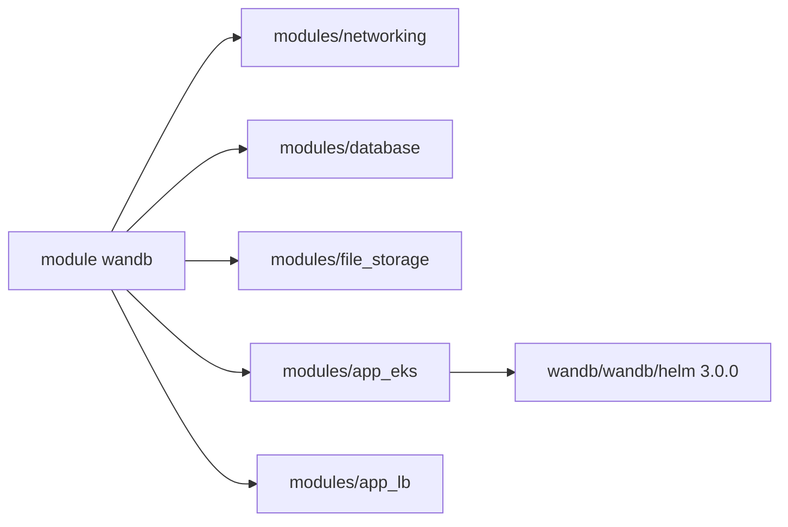

# wandb/terraform-aws-wandb

> Terraform module that installs a private Weights & Biases instance on AWS, for enterprise MLOps teams.

## The problem
Deploying the self-hosted version of W&B on AWS by hand means assembling network, database, storage, DNS and Kubernetes.

## What it actually does
The module creates on AWS an EKS cluster, an Aurora MySQL database, a Redis, an S3 bucket, an ALB load balancer, Route53 DNS, an ACM certificate and KMS keys. It then installs the application via the Helm chart wandb/wandb/helm. Five sizes (`small` to `xxlarge`) set the instances, overridable variable by variable. External storage (BYOB) has three permission modes: `strict`, `restricted`, `public`.

## How it is wired

Simplified diagram based on the sheet, no diagram provided.

## Trying it
```bash
terraform init
terraform apply
```

## Cost and gotchas
You need an AWS account with rights over about ten services, Terraform >= 1.9 and a domain (Route53 zone or `external_dns`). The AWS bill (EKS, Aurora, Redis) is on you. The README warns: beta version, incompatible with previous ones, not intended for production without contacting the Customer Success Manager.

## What it is not
Not hosted W&B: it is the self-hosted distribution, which falls under an enterprise offering. BYOB's `public` mode opens cross-account S3 access. ACM certificate validation can take two hours and make the apply fail.

## Alternatives
- The hosted W&B service (wandb.ai): no infrastructure to manage, but it is a SaaS (cited in the README).

## For you
Worth watching: useful only if your company has a self-hosted W&B license on AWS, and the module is still in beta.
