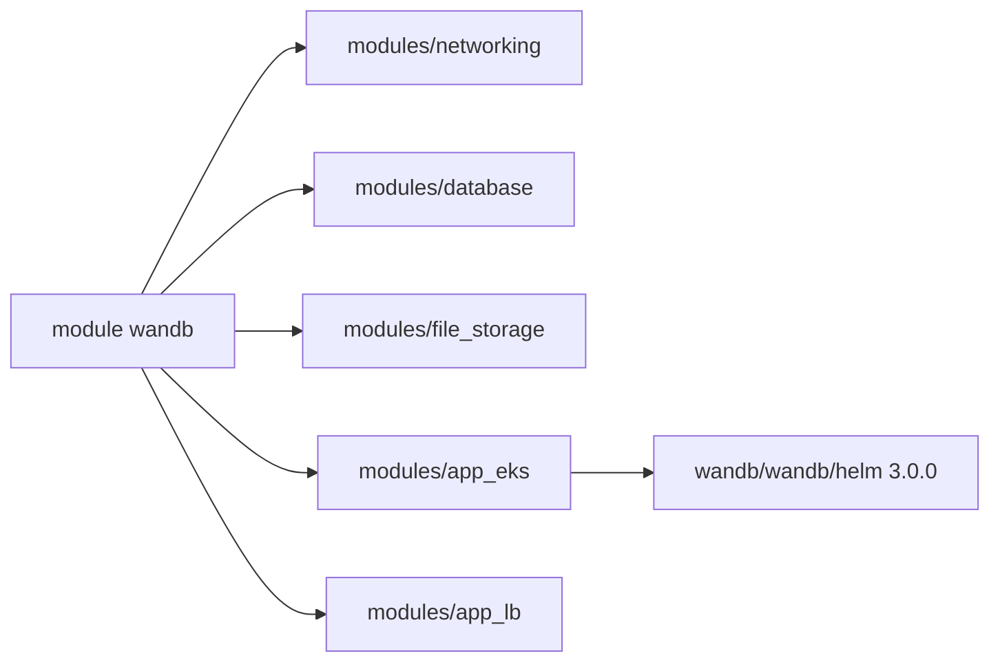

# wandb/terraform-aws-wandb

> Module Terraform qui installe sur AWS une instance privée de Weights & Biases, pour équipes MLOps en entreprise.

## Le problème
Déployer à la main la version auto-hébergée de W&B sur AWS demande d'assembler réseau, base, stockage, DNS et Kubernetes.

## Ce que ça fait vraiment
Le module crée sur AWS un cluster EKS, une base Aurora MySQL, un Redis, un bucket S3, un répartiteur de charge ALB, le DNS Route53, un certificat ACM et des clés KMS. Il installe ensuite l'application via le chart Helm wandb/wandb/helm. Cinq tailles (`small` à `xxlarge`) fixent les instances, surchargeables variable par variable. Le stockage externe (BYOB) a trois modes de permission : `strict`, `restricted`, `public`.

## Comment c'est branché

Schéma simplifié d'après la fiche, sans diagramme fourni.

## Essayer
```bash
terraform init
terraform apply
```

## Coût et pièges
Il faut un compte AWS avec les droits pour une dizaine de services, Terraform >= 1.9 et un domaine (zone Route53 ou `external_dns`). La facture AWS (EKS, Aurora, Redis) est à ta charge. Le README prévient : version bêta, incompatible avec les précédentes, pas prévue pour la production sans contacter le Customer Success Manager.

## Ce que ce n'est pas
Ce n'est pas W&B hébergé : c'est la distribution auto-hébergée, qui relève d'une offre entreprise. Le mode `public` du BYOB ouvre l'accès S3 inter-comptes. La validation d'un certificat ACM peut prendre deux heures et faire échouer l'apply.

## Alternatives
- Le service W&B hébergé (wandb.ai) : aucune infrastructure à gérer, mais c'est un SaaS (cité dans le README).

## Pour toi
À surveiller : utile seulement si ton entreprise a une licence W&B auto-hébergée sur AWS, et le module est encore en bêta.

