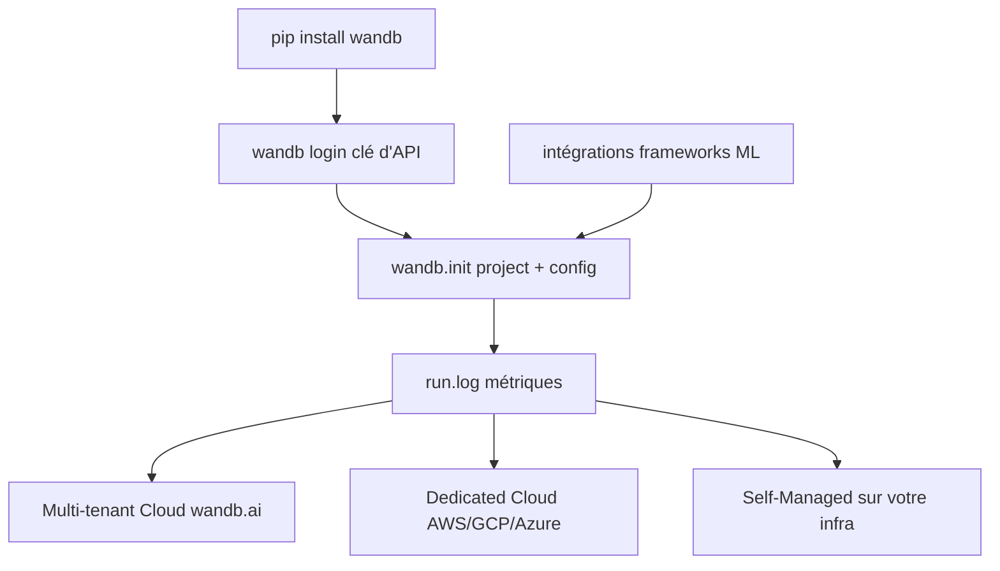

# wandb/wandb

> Python client for ML experiment tracking — metrics, hyperparameters, data versions — to a hosted service.

## The problem
Training results end up in logs, notebooks and file names, and so cannot be found again.
Comparing two runs and knowing what changed becomes an exercise in memory.

## What it actually does
`wandb.init(project=..., config=...)` opens a run; `run.log({...})` sends metrics as they come.
The `with wandb.init(...)` syntax marks the run finished on exiting the block, and failed in case of an exception.
Runs, their curves and their configurations are viewed on wandb.ai; tracking also covers data versioning.
Integrates with common ML frameworks; Weave is the companion suite dedicated to LLM applications.

## How it is wired


## Trying it
```shell
pip install wandb
```

## Cost and gotchas
Account required and an API key — shown only once at creation, so store it in a secrets manager.
Three hosting options: multi-tenant on W&B's GCP (North America), single-tenant Dedicated Cloud, or self-hosted. The last two are commercial offerings.

## What it is not
Not a local tool: the client pushes to a server, hosted by W&B or by you.
Not a training orchestrator: it observes, it launches nothing.
Not the LLM tool from the same vendor: that is Weave, a separate product.

## Alternatives
- Weave: from the same vendor, for tracking and evaluating GenAI applications rather than training runs.

## For you
The de facto standard for experiment tracking: worth adopting, after first checking where your data lands.
